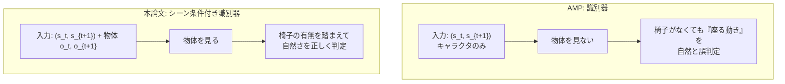
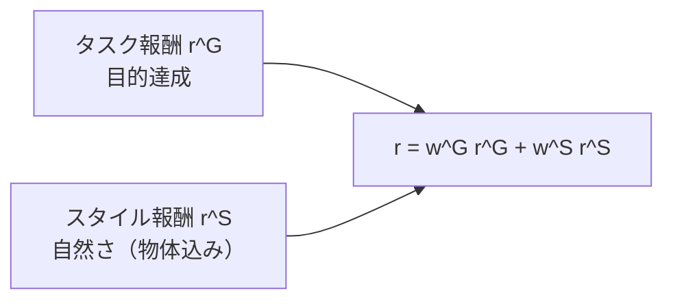
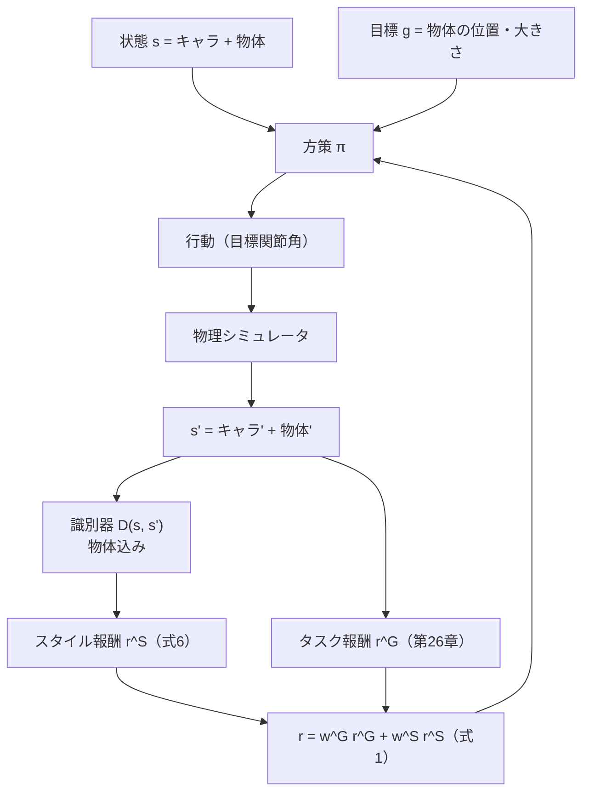

# 27. シーン条件付き識別器に拡張

## この章でわかること

- 識別器に入力するものを「キャラクタ遷移」から「キャラクタ遷移＋物体」へ拡張する
- これがなぜ論文の中核なのか
- 実装上の変更点（わずか）
- 拡張の効果をどう確かめるか

## 前提

- 第08章（シーン条件付き識別器）、第24章（識別器の実装）、第26章（物体）

---

## 1. 論文の中核を一文で

> **識別器が「キャラクタの動き」だけでなく「物体の状態」も見ることで、シーンの文脈で自然さを判定できる。**

AMP（第05章）との違いは、まさにこれだけです。実装も、入力に物体を連結するだけの小さな変更です。

## 2. AMP の識別器 vs シーン条件付き識別器



## 3. 実装の変更点（`scene_env.py`）

変更は `get_amp_obs` だけです。

```python
class HumanoidSceneEnv(RefMotionEnv):
    def get_amp_obs(self, obs, goal):
        """シーン条件付き識別器の入力（第08章）。

        キャラクタ状態と物体状態を連結する。
        """
        return torch.cat([obs, self._object_state], dim=-1)
```

これに対し、物体なしの `humanoid_env.py` は:

```python
def get_amp_obs(self, obs, goal):
    return obs          # 物体なし（AMP 本来）
```

たった1行の違いで、識別器は「物体の文脈込み」で自然さを判定するようになります。

## 4. 識別器側の変更

識別器のネットワークも、入力次元が増えるだけです（`amp.py` / `models.py`）。

```python
# 物体なし
#   amp_obs_dim = obs_dim
# 物体あり（本論文のシーン条件付け）
#   amp_obs_dim = obs_dim + object_dim
discriminator = Discriminator(amp_obs_dim, cfg.hidden_dims)
```

- `amp_obs_dim` が増えると、MLP の入力層のサイズが変わるだけ。
- 学習の手続きはまったく同じ（第24章）。

## 5. なぜこれが「効く」のか

3つの理由があります。

### 5.1 物体の文脈で自然さを判定できる

「椅子があるのに座らない」「椅子がないのに座る」を区別できます（第08章）。識別器の判定が、物体の状態に条件付きます。

### 5.2 目標条件付けと相補的

タスク報酬 $r^G$ は「目的を果たしたか」を評価します。スタイル報酬 $r^S$ は「自然か」を評価します。識別器に物体を入れると、$r^S$ が「**この物体に対して**自然か」を評価できるようになります。



### 5.3 一般化を助ける

物体が変わっても、識別器は「その物体の文脈で自然か」を評価します。ランダム化（第11・26章）で多様な物体を見せることで、識別器も「様々な物体に対する自然さ」を学びます。

## 6. 効果を確かめる実験（アブレーション）

論文のアブレーション（第13章・表S.1）を、ミニ実装で真似できます。**識別器の入力から物体を除く**と、どうなるかを比べます。

| 設定 | 期待される結果 |
| --- | --- |
| 物体を状態に含む（シーン条件付け） | 物体の文脈を踏まえた自然な相互作用 |
| 物体を状態から除く（AMP のまま） | 「物体を無視した」動きになりやすい |

> 論文では、バウンディングボックスを除くと carry の成功率が **0%** になりました（第13章）。物体情報の重要性を示す強い証拠です。

## 7. コード全体の流れ（改めて）



## 8. 実行

```bash
uv run python scripts/train_06_scene.py
```

- 物体込みの `amp_obs` が識別器に入ります。
- 物体なし版（第25章）との比較で、効果を確かめましょう。

## 9. つまずきやすいポイント

| 症状 | 対処 |
| --- | --- |
| 識別器が物体を無視している気がする | 物体特徴のスケール（正規化）を確認 |
| 学習が不安定 | 物体の次元を増やしすぎていないか、入力の正規化を見直す |
| 効果が実感できない | 参照モーションの質、ランダム化の範囲を確認 |

> 物体特徴の**スケール**は重要です。位置がメートル単位で大きく、関節角がラジアン単位で小さいと、識別器が物体に引きずられます。正規化を検討しましょう。

## 10. まとめ

- シーン条件付き識別器は、識別器の入力に物体を連結するだけの小さな変更。
- 効果は大きい: 物体の文脈で自然さを判定でき、一般化を助ける。
- 論文のアブレーション（物体情報を除くと carry 0%）がその重要性を裏付ける。
- 物体特徴のスケール（正規化）に注意。

## 演習

1. `get_amp_obs` から物体を除いた版と含む版を、それぞれ何を学習するか比較しましょう。
2. 物体特徴のスケールが大きすぎると、識別器にどんな偏りが生じるか考察しましょう。
3. 論文の「バウンディングボックスなしで carry 0%」を、あなたのミニ実装で再現するにはどう設計すべきか考えましょう。

---

次章: [28. SMPL 人型へ合流](28_SMPL人型へ合流_SMPLSim.md) ／ 前章: [26. 物体を足して sit / carry 簡略版](26_物体を足してsit_carry簡略.md)
