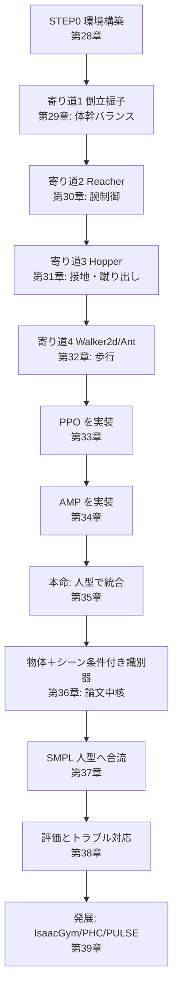

# 27. 実装の全体像 — 何を作るか

## この章でわかること

- 第7部で作るものの全体像（人型本線＋寄り道）
- 論文の本実装（IsaacGym）とこのミニ実装の違い
- 「何につながるか」という視点での各段階の位置づけ
- 実行環境の注意

## 前提

- 第1〜6部の全章

## つながり

- ここまでで「AI側（生成モデル）」と「物理側（RL・AMP）」を学び、論文（第6部）を読みました。この部は、それらを**手を動かして統合**します。

---

## 1. この部のゴール

> **MuJoCo と PyTorch（CPU）で、AMP による物理キャラクタ制御を小さく実装し、最後に「物体との相互作用（シーン条件付き識別器）」まで到達する。**

論文の完全な再現ではありません。**核となる考え方と実装を、手が届く規模で体験する**のが目的です。

## 2. 論文の本実装との違い

| 項目 | 論文 | このミニ実装 |
| --- | --- | --- |
| シミュレータ | IsaacGym（GPU 必須） | MuJoCo（CPU で動く） |
| 並列環境数 | 数千 | 数十 |
| キャラクタ | 論文独自の剛体人型 | MuJoCo `humanoid.xml` → SMPL |
| データ | SAMP・AMASS 等の MoCap | 手続き生成の参照モーション、後に AMASS |
| タスク | sit / lie down / carry | 「物体へ近づいて合わせる」に簡略化 |
| 学習時間 | 数時間〜数日（GPU） | 数分〜数時間（CPU、縮小） |

> **この環境（CPU・メモリ約5GiB・CUDAなし）では本実装は動きません。** 本文のコードは読者が自分の環境で動かす前提で、本リポジトリでは実行・検証していません。

## 3. ロードマップ — 人型本線＋寄り道



## 4. 各寄り道は「何につながるか」

| 寄り道 | 学ぶ能力 | 人型での対応 | 論文のどの概念に対応するか |
| --- | --- | --- | --- |
| 倒立振子 | 姿勢の維持 | 体幹バランス（立つ・座る） | 早期終了、直立報酬（第17章） |
| Reacher | 腕の目標追従 | 手を伸ばす・箱を持つ | シーン条件付けの入り口（第22章） |
| Hopper | 接地・蹴り出し | 歩行、立ち上がり | 接触、PD制御（第12章） |
| Walker2d / Ant | 周期運動と歩容 | 物体へ歩いて近づく | 速度報酬 $r^{\text{far}}$（第25章） |
| 人型 AMP | 自然な歩行のスタイル | 動きの自然さ | スタイル報酬 $r^S$（第22章） |
| 物体＋シーン条件 | 物体の文脈で判断 | sit / carry | シーン条件付き識別器（第22章） |

## 5. コードの構成

```
src/ml_lern/
  core/
    mujoco_basics.py  MuJoCo の基本（第11〜13章）
    rl_basics.py      RL の基本・GAE（第14〜15章）
    rewards.py        報酬設計（第17・25章）
    imitation.py      模倣学習（第18章）
    models.py         方策・価値関数・識別器（第16・19・20章）
    ppo.py            PPO（第16章）
    amp.py            AMP の識別器・スタイル報酬（第19・20章）
    rollout.py / buffer.py / config.py
  charcontrol/
    envs/
      base.py          環境ラッパの基底（RSI・ランダム化）
      pendulum.py      寄り道1（第29章）
      reacher.py       寄り道2（第30章）
      locomotion.py    寄り道3・4（第31・32章）
      humanoid_env.py  本命（第35章）
      scene_env.py     物体＋シーン条件付き識別器（第36章）
      smpl_humanoid.py SMPL 人型（第37章）
    train.py           学習ループ
scripts/
  p01〜p04              第3〜5部のデモ
  train_01〜train_07    第7部の学習エントリ
```

## 6. 進め方の推奨

1. **第28章**で環境を構築し、MuJoCo の制御の基本を押さえる。
2. **第29〜32章**の寄り道を回し、RL のループに慣れる。各章の「つながり」を意識する。
3. **第33〜34章**で PPO と AMP を実装する。
4. **第35〜36章**で人型に統合し、物体を足して論文の中核に到達する。
5. **第37章**で SMPL 人型へ合流する。

## 7. 前提ソフトウェア

- Python 3.13（uv で管理）
- PyTorch（CPU）
- MuJoCo と gymnasium
- （任意）mujoco-viewer、matplotlib

## まとめ

- 第7部は、AMP による物理キャラ制御を MuJoCo + PyTorch で小さく再現する。
- 人型を本線に、4つの寄り道で能力を積み上げる。各寄り道は人型の能力に対応する。
- 論文の本実装（IsaacGym）とは規模が違うが、核となる部品は同じ。
- この環境では実行しない。読者の環境で動かす前提。

## 手を動かそう

> **一歩目**: ロードマップを自分の目標に合わせて書き換える。「このゲームのこの動作を、どの章で、どの規模で作るか」。

**いじってみる**: 自分のマシン（GPU の有無）に合わせて、`num_envs` や学習時間の見積もりを書く。ミニ実装で先に試す項目と、GPU 機でしかやらない項目を分ける。

**夢が広がる**:
- 「いつか作りたいキャラ AI」のロードマップを作る。
- ミニ実装→GPU→論文再現→自作への道筋を、自分のプロジェクトに当てはめる。
- 学習で作りたい機能を3つ選び、優先順位をつける。

## 演習

1. 4つの寄り道を、それぞれ「人型のどの能力につながるか」とともに説明しましょう。
2. ミニ実装と論文の本実装の違いを3つ挙げ、それぞれ学習結果にどう影響するか考察しましょう。

---

次章: [28. 環境構築](28_環境構築.md)
