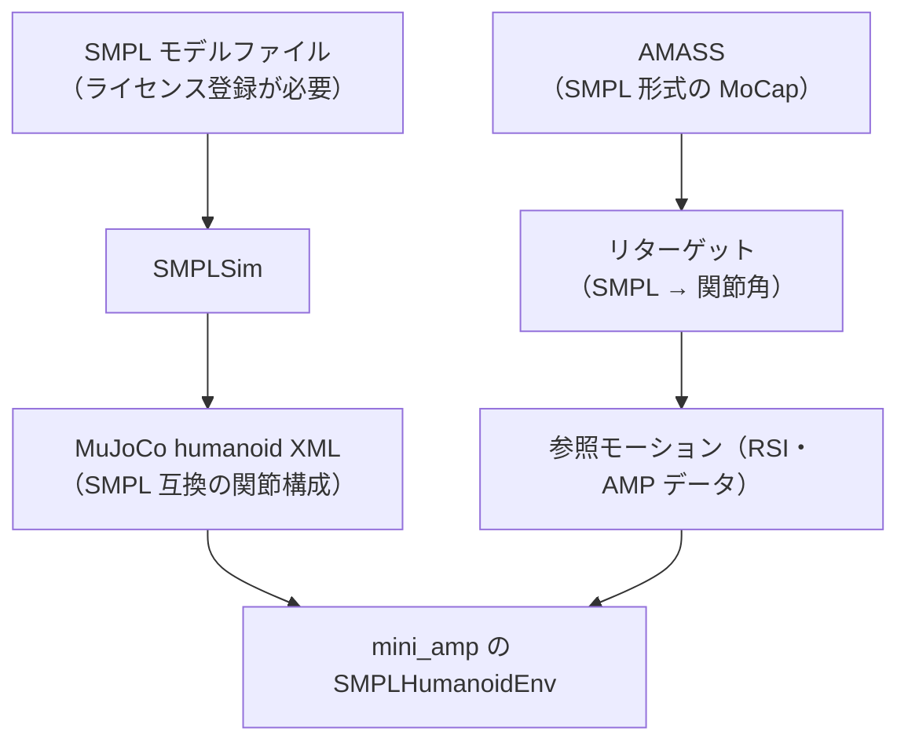

# 28. SMPL 人型へ合流

## この章でわかること

- SMPL とは何か、なぜ「そのままでは物理制御できない」のか
- SMPL を MuJoCo の人型に変換する流れ（SMPLSim）
- AMASS を参照モーションとして使う方法
- ライセンスと注意点

## 前提

- 第09章（状態）、第10章（データ）、第27章（シーン条件付き識別器）

---

## 1. SMPL とは

**SMPL（Skinned Multi-Person Linear model）** は、人体の**メッシュ（表面形状）**を表す統計モデルです。

- パラメータ:
  - **体型 $\beta$**（体の太さ・背丈など）
  - **姿勢 $\theta$**（関節の回転。ルート＋各関節）
  - **ルート位置 $\mathbf{t}$**
- 出力: 6890頂点のメッシュ。

> Matthew Loper, Naureen Mahmood, Javier Romero, Gerard Pons-Moll, Michael J. Black.
> **SMPL: A Skinned Multi-Person Linear Model.**
> ACM TOG 34(6), 2015. <https://smpl.is.tue.mpg.de/>

## 2. なぜ SMPL をそのまま物理制御できないのか

ここが重要です。SMPL は**運動学（キネマティクス）モデル**であり、**物理（ダイナミクス）を持ちません**。

- SMPL は「関節角を与えるとメッシュがどう変形するか」を計算します。
- 「関節にトルクをかけるとどう動くか」は計算しません。それは物理シミュレータの仕事です。

第02章・第06章で学んだとおり、物理キャラ制御には**剛体リンク＋関節＋トルク**が必要です。SMPL のメッシュをそのままシミュレータに投入しても動きません。


## 3. 変換の流れ — SMPL → MuJoCo humanoid

この変換を担うのが **SMPLSim**（ZhengyiLuo 氏）です。

> SMPLSim: <https://github.com/ZhengyiLuo/SMPLSim>
> 関連: PHC（ICCV 2023）<https://github.com/ZhengyiLuo/PHC>
> PULSE（ICLR 2024）

SMPLSim は「SMPL/SMPLH/SMPLX から MuJoCo（および IsaacGym）用の humanoid XML を生成する」ライブラリで、簡単な PPO も含みます。



### 生成される humanoid の特徴

- SMPL の関節構成（骨盤ルート、脊椎、四肢）に対応した剛体リンク。
- 体型パラメータ $\beta$ を変えれば、体格の異なるキャラクタも生成できる。
- カプセルベース（軽量）とメッシュベース（見た目重視）を選べる。

## 4. AMASS を参照モーションにする

**AMASS（Archive of Motion Capture as Surface Shapes）** は、SMPL 形式に統一された大規模 MoCap データベースです。

> AMASS: <https://amass.is.tue.mpg.de/>

- 数千のモーション（歩行、走行、ダンス、座る、など）。
- すべて SMPL 形式なので、SMPL 人型と相性が良い。

### リターゲットが必要

AMASS は「SMPL の関節角」を持ちますが、MuJoCo humanoid は「別の関節構成」です。そのままでは使えないため、**リターゲット**（関節の対応付け・最適化）が必要です。


参考:

- PHC の `fit_smpl_motion.py` … SMPL モーションをロボットへフィット。
- TrackerLab … SMPL/AMASS/FBX をリターゲット。

## 5. 実装へのつなぎ（`smpl_humanoid.py`）

`SMPLHumanoidEnv` は、生成済みの SMPL humanoid XML をシーンに使うだけです（第26章の `HumanoidSceneEnv` を継承）。

```python
class SMPLHumanoidEnv(HumanoidSceneEnv):
    def __init__(self, cfg, smpl_xml_path="assets/smpl/humanoid.xml", amass_ref_path=None, device="cpu"):
        with open(smpl_xml_path, "r", encoding="utf-8") as f:
            scene_xml = f.read()
        super().__init__(cfg, device=device, scene_xml=scene_xml)
        self._load_amass_reference()
```

使い方（読者の環境で）:

1. SMPL モデルと AMASS をライセンス登録のうえ取得。
2. SMPLSim で `humanoid.xml` を生成。
3. AMASS のモーションをリターゲットし、参照モーションに変換。
4. `SMPLHumanoidEnv` で学習。

## 6. 事実確認: この系譜は論文とどう違うか

ここは誤解しやすいので、丁寧に整理します。

| 項目 | 本論文（Hassan et al. 2023） | SMPL 系（PHC / PULSE など） |
| --- | --- | --- |
| キャラクタ | 論文独自の剛体人型（IsaacGym） | SMPL から変換した物理人型 |
| データ | SAMP（sit/lie）＋自作 carry（SMPL系表現） | AMASS（SMPL 形式） |
| 目的 | シーン相互作用（物体との接触） | 単一キャラのモーション模倣（物体なしが多い） |
| 識別器 | シーン条件付き（物体を見る） | 通常の AMP 系（キャラのみ） |

つまり **SMPL 系は「本論文の系列そのもの」ではなく、関連する別系列**です。両者の共通点は「物理人型を AMP 系で制御する」こと。本教科書は、本論文を主軸にしつつ、**SMPL を使えばより本格的な人体モデルで実験できる**という発展として紹介しています。

## 7. ライセンスと注意（重要）

SMPL と AMASS は**無償ですが登録制**で、利用条件があります（付録Dに詳細）。

- **SMPL**: <https://smpl.is.tue.mpg.de/> で登録してモデルをダウンロード。非商用ライセンス。
- **SMPL-X**: <https://smpl-x.is.tue.mpg.de/>
- **AMASS**: <https://amass.is.tue.mpg.de/> で登録。研究用途。
- **商用利用**には別途ライセンス（Meshcapade など）が必要な場合があります。

> **注意**: 本リポジトリには SMPL モデル・AMASS データを含めません。各自でライセンスに同意のうえ取得してください。また、SMPLSim の一部は CUDA 前提のため、この CPU 環境では実行しません。

## 8. つまずきやすいポイント

| 症状 | 対処 |
| --- | --- |
| XML が生成できない | SMPLSim のセットアップ、Python バージョン（3.8 系を要求する版あり）を確認 |
| モーションがずれる | リターゲットの対応付け・座標系（Z 軸下向き等）を確認 |
| 関節が足りない/多い | extend_config などで関節を追加（PHC の設定を参照） |
| 動かない/埋まる | 足元の高さ合わせ、SMPL の座標系変換を確認 |

## 9. まとめ

- SMPL はメッシュ（運動学）で、そのままでは物理制御できない。
- SMPLSim で SMPL → MuJoCo humanoid XML に変換する。
- AMASS を参照モーションに使うにはリターゲットが必要。
- SMPL 系は論文と関連する別系列。ライセンス登録が必要で、本リポジトリでは実行しない。

## 演習

1. SMPL をそのまま物理シミュレータに入れても動かない理由を、「運動学」と「ダイナミクス」の違いから説明しましょう。
2. SMPL 人型を生成する利点（体型の多様性など）を2つ挙げましょう。
3. AMASS を参照モーションに使うとき、リターゲットが必要な理由を関節構成の観点で述べましょう。

---

次章: [29. 評価とトラブルシューティング](29_評価とトラブルシューティング.md) ／ 前章: [27. シーン条件付き識別器に拡張](27_シーン条件付き識別器に拡張.md)
