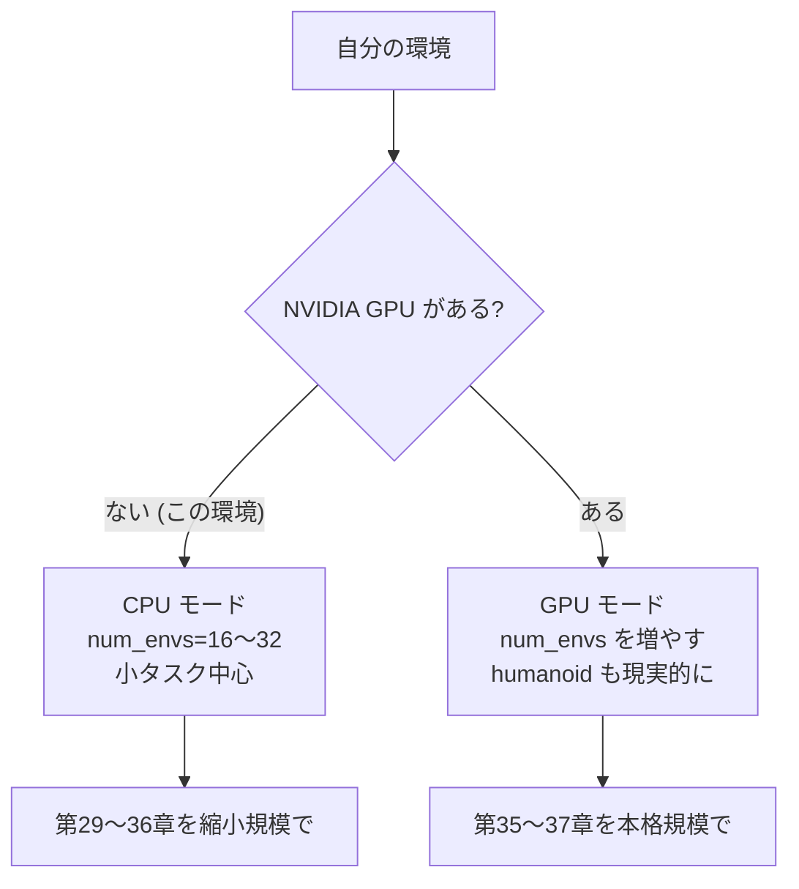

# 28. 環境構築 — PyTorch と MuJoCo

## この章でわかること

- このプロジェクトの依存関係と、`uv` での導入方法
- CPU・aarch64 環境での注意点
- 動作確認の手順
- つまずきやすいポイント

## 前提

- ターミナル操作の基本

---

## 1. 依存関係

`pyproject.toml` の optional-dependencies に、学習用の依存をまとめています（既定では導入しません）。

```toml
[project.optional-dependencies]
train = ["torch>=2.3", "mujoco>=3.1", "gymnasium>=1.0", "numpy>=1.26"]
viz   = ["matplotlib>=3.8"]
```

```bash
# 学習用の依存を導入
uv sync --extra train --extra viz
```

## 2. CPU・aarch64 での注意

| 項目 | 注意 |
| --- | --- |
| CUDA | 使えない。`torch.device("cpu")` を使う（`config.device = "cpu"`） |
| メモリ | 約 5GiB。`num_envs` は小さく（16〜32） |
| 並列環境数 | 論文の数千は無理。数十で我慢し、学習は控えめに |
| 学習時間 | CPU では遅い。まず小さいタスク（倒立振子）で動作確認 |
| IsaacGym | 動かない（第39章で手順のみ紹介） |

> aarch64 でも `torch` と `mujoco` はホイールが提供されています。

## 3. 動作確認

### 3.1 ライブラリ

```bash
uv run python -c "import torch, mujoco, gymnasium; print(torch.__version__, mujoco.__version__, gymnasium.__version__)"
```

### 3.2 MuJoCo の簡単な動作確認

```bash
uv run python scripts/p01_mujoco_basics.py
```

観測・行動の次元、ランダム行動のロールアウト結果が表示されれば成功です。

### 3.3 学習スクリプト

```bash
uv run python scripts/p03_ppo.py     # 倒立振子を PPO で学習
```

コンソールにログ（`ep_return`, `pi_loss` など）が流れ始めれば成功です（Ctrl-C で停止）。

## 4. 実行環境の選び方



> 本格的に humanoid や scene を学習させたいなら、**NVIDIA GPU のあるマシン**を推奨します。CPU でも動きますが時間がかかります。

## 5. つまずきやすいポイント

| 症状 | 対処 |
| --- | --- |
| `ModuleNotFoundError: mujoco` | `uv sync --extra train` |
| `torch` の導入が遅い/失敗 | CPU ホイールを明示 |
| 画面が開かない（可視化） | headless。ログだけで確認 |
| メモリ不足 | `num_envs` を減らす、`episode_length_s` を短く |
| 学習が遅すぎる | まず倒立振子で確認してから人型へ |

## 6. ディレクトリの確認

```
ml-lern/
  docs/            この教科書
  src/ml_lern/
    foundations/   第1部
    generative/    第2部
    core/          第3〜5部（MuJoCo・RL・AMP）
    charcontrol/   第6〜7部（環境・学習）
  scripts/         学習・デモのエントリ
```

## まとめ

- `uv sync --extra train --extra viz` で依存を導入。
- この環境は CPU・CUDA なし。`num_envs` を小さくして進める。
- 倒立振子で動作確認してから、人型へ進む。
- 本格学習は GPU 機を推奨。

## 演習

1. 自分の環境に依存を導入し、バージョンを確認しましょう。
2. `scripts/p01_mujoco_basics.py` を実行し、各環境の観測・行動の次元を確認しましょう。

---

次章: [29. 寄り道1 — 倒立振子](29_寄り道1_倒立振子.md) ／ 前章: [27. 実装の全体像](27_実装の全体像.md)
