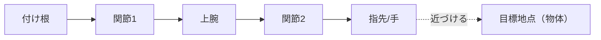
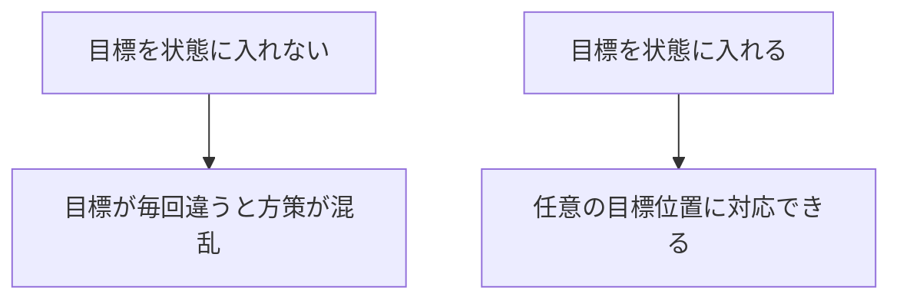

# 30. 寄り道2 — Reacher と腕制御

> **この寄り道は何につながるか**
> アームの先端を目標地点へ動かす＝**腕を伸ばす**。人型が「手を箱に伸ばす」「物を支える」ための最小モデルです。
> さらに、「目標（物体）を状態に含める」という**シーン条件付けの入り口**を学びます（第22章に直結）。

## この章でわかること

- 2関節アームで目標に届くタスク
- 目標（物体）を状態に入れる意味
- 「物体を状態に含める」がなぜ論文で重要か

## 前提

- 第13章（状態設計）、第22章（シーン条件付け）

---

## 1. タスク

2関節のアームを動かし、指先を目標地点に近づけます。



ゲームでいう「腕を伸ばしてスイッチを押す」に相当します。

## 2. ここが最初の「シーン条件付け」

重要なポイント: Reacher は**目標地点の位置**を観測に含みます。これを論文流に「物体（シーン）」として扱うと、シーン条件付けの練習になります。

```python
def get_amp_obs(self, obs, goal):
    # キャラクタ状態に物体（目標）特徴を連結する
    state, obj = self._split(obs)
    return torch.cat([state, obj], dim=-1)
```

> **つながり**: この「状態＋物体」の連結が、そのまま論文の**シーン条件付き識別器**（第22章）の入力になります。第36章では、ここに椅子や箱の情報が入ります。

## 3. 報酬 — 目標に近いほど高い

$$
r = \exp(-10\, \|\mathbf{x}_{\text{hand}} - \mathbf{x}_{\text{target}}\|^2)
$$

これは論文の $r^{\text{near}}$（式(9)、第25章）と同型です。係数 10 は「正確に合わせる」ことを要求します。

```python
def task_reward(self, obs, goal, action, next_obs):
    _, obj_next = self._split(next_obs)         # 目標への相対座標
    dist2 = obj_next.pow(2).sum(dim=-1)
    return torch.exp(-10.0 * dist2)
```

## 4. なぜ「目標を状態に入れる」のが本質なのか

- 目標（物体）が状態にないと、方策は「どこへ動けばいいか」の手がかりがありません。
- 目標を状態に入れることで、**同じ方策が任意の目標に対応**できます（目標条件付き方策）。



これは論文の「物体を状態に入れる」設計（第23章）の最小例です。

## 5. 実行

```bash
uv run python scripts/train_02_reacher.py
```

## 6. 「つながり」のまとめ

| Reacher で学ぶこと | 人型/論文での対応 |
| --- | --- |
| 腕の目標追従 | 手を伸ばす・箱を持つ |
| 目標（物体）を状態に | シーン条件付け（第22章） |
| $\exp(-k d^2)$ の近距離報酬 | $r^{\text{near}}$（第25章の式9） |
| 目標条件付き方策 | 任意の物体配置に対応 |

## 7. Reacher の限界と次へ

Reacher は腕だけ、物体も「点」です。実際の carry では:

- 腕だけでなく**全身**（歩いて近づく、体幹で支える）が必要。
- 物体は**剛体**で、押せば動く。
- 手は物体に**接触**して支える（固定されない）。

これらは次の寄り道（歩行、第31・32章）と本命（第35・36章）で扱います。

## 8. 実装コード

- `src/ml_lern/charcontrol/envs/reacher.py` … `ReacherEnv`
- `scripts/train_02_reacher.py` … 学習のエントリ

## まとめ

- Reacher は「腕を伸ばす」の最小モデル。
- 目標（物体）を状態に含めることで、シーン条件付けの入り口を体験する。
- 近距離報酬 $\exp(-kd^2)$ は論文の $r^{\text{near}}$ と同型。
- 全身・剛体・接触は次の寄り道と本命で発展させる。

## 手を動かそう

> **一歩目**: Reacher で「目標を状態から除く」版と「含む」版を作り、学習の成否を比べる。

```python
def get_amp_obs(self, obs, goal):
    state, obj = self._split(obs)
    # return state                 # 目標を除く（学習しにくい）
    return torch.cat([state, obj], -1)   # 目標を含む（推奨）
```

**いじってみる**: 目標を毎エピソードランダムに変え、目標条件付き方策が任意の目標に対応できるかを確認する。

**夢が広がる**:
- ゲームの「腕でスイッチを押す」「物を掴む」を学習で作る。
- 目標（敵、宝、スイッチ）を状態に入れて、任意の位置に対応する AI を作る。
- ロボットアームやクレーンの操作に応用する。

**再現レシピ**: [レシピ31（付録F）](付録F_再現レシピ_物理側.md#recipe-31)（コメント付きの再現コードで試せます）

## 演習

1. 目標地点を状態から除いたら、方策はどう振る舞うと予想されますか。
2. 報酬の係数 10 を 1 に変えると、精度はどう変わるか予想しましょう。
3. Reacher と論文の carry の違いを、状態・行動・物体の3点で整理しましょう。

---

次章: [31. 寄り道3 — Hopper](31_寄り道3_Hopper.md) ／ 前章: [29. 寄り道1 — 倒立振子](29_寄り道1_倒立振子.md)
