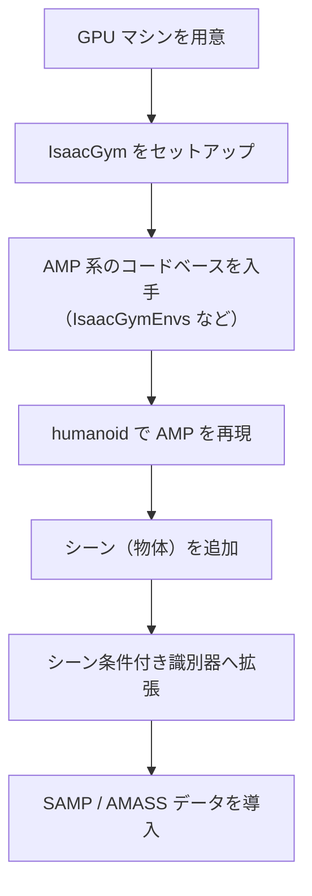
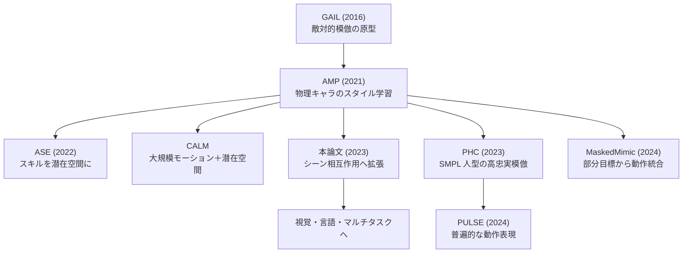
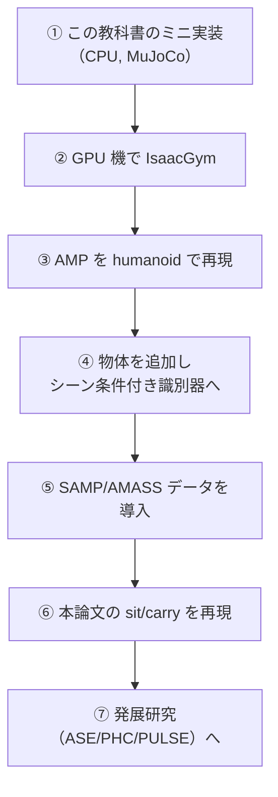

# 30. 発展 — IsaacGym と PHC / PULSE への道

## この章でわかること

- 論文の本実装（IsaacGym）に進むための手順
- 関連研究の地図（PHC / PULSE / ASE / MaskedMimic など）
- 自分の環境で本格版を動かすための現実的な道筋
- この教科書を終えた後の学習ロードマップ

## 前提

- 第III部の全章

---

## 1. 本実装（IsaacGym）に進む

論文のコードは **IsaacGym**（NVIDIA）を前提とします。IsaacGym は GPU 必須です（第06章）。

### 進むための要件

| 項目 | 要件 |
| --- | --- |
| GPU | NVIDIA GPU（CUDA 対応） |
| ドライバ | CUDA 対応の NVIDIA ドライバ |
| OS | Linux（Ubuntu 推奨） |
| Python | IsaacGym の対応バージョン |

### 手順の概略

参考リポジトリ:

- **IsaacGymEnvs**（NVIDIA）: AMP を含む強化学習環境集。 <https://github.com/isaac-sim/IsaacGymEnvs>
- **AMP 公式**: <https://xbpeng.github.io/projects/AMP/index.html>
- **ASE / CALM / MaskedMimic**（Peng らの後続）: より発展的な AMP。

> **このデバイスでは IsaacGym は動きません**（virtio 仮想 GPU、CUDA なし。第16章）。本格版は GPU マシンで。

## 2. 関連研究の地図

本論文の周辺には、AMP を発展させた研究が多数あります。位置づけを整理します。

| 研究 | 一言 | 本論文との関係 |
| --- | --- | --- |
| GAIL | 敵対的模倣の原型 | 源流 |
| AMP | 物理キャラのスタイル学習 | 直接の土台 |
| ASE | スキルを潜在空間へ | 発展 |
| CALM | 大規模モーション＋潜在空間 | 発展 |
| PHC | SMPL 人型の高忠実模倣 | 別系列（SMPL・第28章） |
| PULSE | 普遍的動作表現 | PHC の発展 |
| MaskedMimic | 部分目標から動作統合 | 発展 |

## 3. PHC / PULSE の位置づけ

第28章で触れた SMPL 系の代表です。

- **PHC（Perpetual Humanoid Control, ICCV 2023）**
  - SMPL 人型を物理シミュレーションで制御し、MoCap を高忠実に模倣。
  - 転倒からの回復、ノイズの多い入力への頑健性。
  - <https://github.com/ZhengyiLuo/PHC>
- **PULSE（ICLR 2024）**
  - 普遍的な人体動作の潜在表現。PHC の発展。
- **SMPLSim**
  - SMPL → MuJoCo/IsaacGym の humanoid 生成。

本論文（シーン相互作用）と PHC（モーション模倣）は目的が違いますが、**「物理人型を AMP 系で制御する」**という土台を共有します。両方を学ぶと、視野が広がります。

## 4. 本格版に進む際の現実的な道筋

各段階で、この教科書のどの章が効くかを示します。

| 段階 | 効く章 |
| --- | --- |
| ② IsaacGym 導入 | 第06・16章 |
| ③ AMP 再現 | 第05・23・24・25章 |
| ④ シーン条件付け | 第08・26・27章 |
| ⑤ データ導入 | 第10・28章・付録D |
| ⑥ sit/carry 再現 | 第07・12・13章 |

## 5. 計算資源の現実

| 環境 | できること |
| --- | --- |
| このデバイス（CPU, 5GiB, CUDAなし） | 倒立振子〜Walker 程度。humanoid は遅い |
| デスクトップ GPU（1枚） | humanoid の AMP、シーン条件付けまで |
| 複数 GPU / クラウド | 本論文の規模（数千環境）に近づける |

> 学習にかかる時間は、CPU で数時間〜数日、GPU で数時間、というのがおおよその感覚です（タスクによる）。

## 6. この教科書を終えた後のロードマップ

さらに学ぶべきトピック:

- **ビジョンと言語**: キャラクタが環境を「見て」、指示に従う（本論文の将来課題、第14章）。
- **マルチタスク RL**: 1つの方策で複数タスク（第14章の限界）。
- **Sim-to-Real**: シミュレーションの制御を実ロボットへ（関連: ASAP, Holosoma）。
- **拡散モデル**: 生成モデルによる動作生成（付録B）。

## 7. よくある質問

**Q. GPU がないと無理ですか？**
A. この教科書のミニ実装は CPU で動きます。本格版（humanoid、数千環境）は GPU を強く推奨します。

**Q. 論文の完全な再現は必要ですか？**
A. まずは「AMP の核」と「シーン条件付け」を理解することが重要です。完全再現は GPU とデータ（ライセンス）が必要です。

**Q. SMPL は必須ですか？**
A. 必須ではありません。MuJoCo の標準 humanoid でも、核となる考え方は体験できます（第25章）。SMPL はより本格的な人体モデルを使いたいときの選択肢です（第28章）。

## 8. まとめ

- 本実装は IsaacGym（GPU 必須）。この環境では動かない。
- 関連研究の地図（ASE / CALM / PHC / PULSE / MaskedMimic）を把握する。
- 現実的な道筋は、ミニ実装 → GPU で IsaacGym → AMP 再現 → シーン条件付け → データ導入 → sit/carry。
- その先に、ビジョン・言語・マルチタスク・Sim-to-Real がある。

## 演習

1. 自分の計算資源で、どの段階まで到達できそうか、現実的に計画を立てましょう。
2. PHC（モーション模倣）と本論文（シーン相互作用）の共通点と相違点を整理しましょう。
3. 「キャラクタに目（ビジョン）を持たせる」と、本論文の何が改善されるか考察しましょう。

---

第III部はここまで。付録: [付録A 用語集](付録A_用語集.md) ／ [付録B 拡散モデル](付録B_拡散モデルで動作を作る.md) ／ [付録C 演習問題](付録C_演習問題.md) ／ [付録D 参考リソースとライセンス](付録D_参考リソースとライセンス.md)
