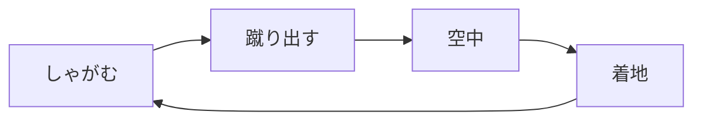
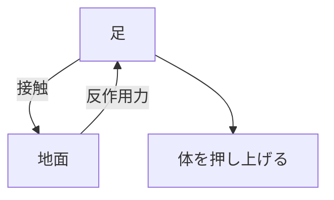
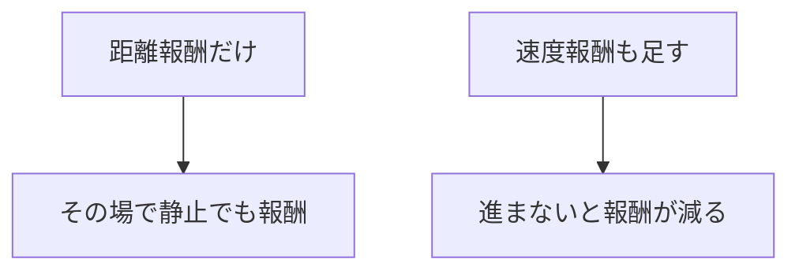

# 31. 寄り道3 — Hopper で接地と蹴り出し

> **この寄り道は何につながるか**
> 片足で跳ねて前進する＝**接地と蹴り出し**。人型が「歩く」「立ち上がる」ための最初の一歩です。
> 「接触」という物理現象と、「速度を報酬で促す」技術（論文の $r^{\text{far}}$、第25章の式(8)）を学びます。

## この章でわかること

- 片足ロボット（Hopper）の前進タスク
- 接地と蹴り出しという物理
- 速度報酬の重要性（じっとしている抜け道を塞ぐ）

## 前提

- 第12章（PD制御・接触）、第17章（速度報酬）、第25章（式8）

---

## 1. タスク

一脚のロボットが、跳ねて前へ進みます。



ゲームでいう「ジャンプ＆着地」のループです。

## 2. 接地と接触 — 物理の核心

Hopper を学ぶ最大の価値は、**接触（contact）**を扱うことです（第12章）。

- 足が地面に着く瞬間、接触力が発生します。
- 蹴り出しは、足で地面を押す反作用です。
- 接触を誤ると、足が滑ったり、地面にめり込んだりします（第26章の運動学モデルの失敗）。



**人型へのつながり**: 座る・立つは、足と地面、腰と椅子の接触の連続です。接地を正しく扱えるかが物理キャラの成否を分けます。

## 3. 行動と状態

- **行動**: 股・膝・足首の**目標角**（PD制御、第12章）。
- **状態**: 胴体の位置・角度・速度、関節角・関節速度。

人型の「脚」を1本にしたモデルです。

## 4. 報酬 — 速度への追従

第17章・第25章のパターンを使います。論文の $r^{\text{far}}$（式(8)）の速度項と同型です。

$$
r = \exp\!\big(-2\,(v^* - v)^2\big) + 0.1
$$

- $v^* = 1.5$ m/s … 目標速度。速すぎても遅すぎても減点。

```python
def task_reward(self, obs, goal, action, next_obs):
    speed = self._forward_speed(next_obs)              # obs[0] が前進速度
    speed_reward = torch.exp(-2.0 * (self.target_speed - speed).pow(2))
    alive = torch.ones_like(speed_reward)
    return 1.0 * speed_reward + 0.1 * alive
```

> **つながり**: 論文の sit の $r^{\text{far}}$（式(8)）は「距離項＋速度項」です。この速度項が、キャラクタを「物体へ歩いて近づく」よう導きます。

## 5. なぜ速度報酬が要るのか — 「じっとしている抜け道」

距離報酬だけだと、**その場で立っているだけでも一定の報酬**をもらえます。速度項を入れることで、「適切な速さで進む」ことを要求し、この抜け道を塞ぎます（第17章）。



## 6. 実行

```bash
uv run python scripts/train_03_hopper.py
```

## 7. 「つながり」のまとめ

| Hopper で学ぶこと | 人型/論文での対応 |
| --- | --- |
| 接地・接触 | 足と地面、腰と椅子の接触 |
| 蹴り出し | 歩行の推進力、立ち上がり |
| 速度報酬 | $r^{\text{far}}$ の速度項（式8） |
| PD 制御の目標角 | 全関節の制御 |

## 8. 限界と次へ

Hopper は1本足で、安定が難しいタスクです（よく転びます）。転倒を避けるために体幹を保つ必要があり、次の二足歩行（Walker2d）でより人型に近づきます。

## 9. 実装コード

- `src/ml_lern/charcontrol/envs/locomotion.py` … `HopperEnv`
- `scripts/train_03_hopper.py`

## まとめ

- Hopper は「接地と蹴り出し」の最小モデル。物理の接触を扱う。
- 速度報酬で「じっとしている抜け道」を塞ぐ（論文の速度項と同型）。
- 接地・接触の扱いは、座る・立つにも直結する。

## 演習

1. 速度報酬を距離報酬だけに置き換えたら、どんな抜け道を学習しうるか述べましょう。
2. 接触を無視した（運動学だけの）Hopper を想像し、どんな不自然さが出るか考察しましょう。
3. Hopper と人型の「歩行」の違いを、脚の本数と安定性の観点で述べましょう。

---

次章: [32. 寄り道4 — Walker2d と Ant](32_寄り道4_Walker2dとAnt.md) ／ 前章: [30. 寄り道2 — Reacher](30_寄り道2_Reacher.md)
