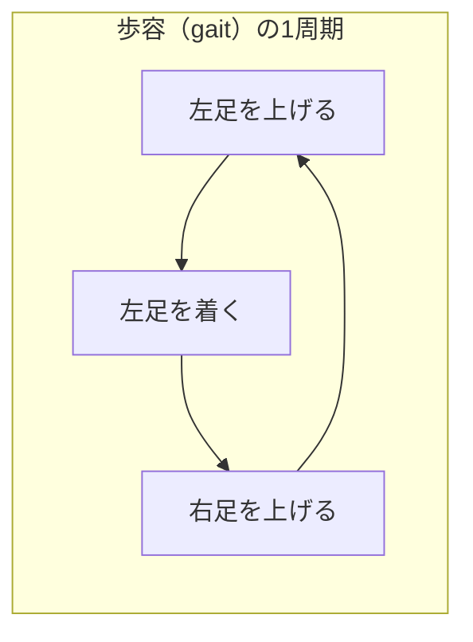
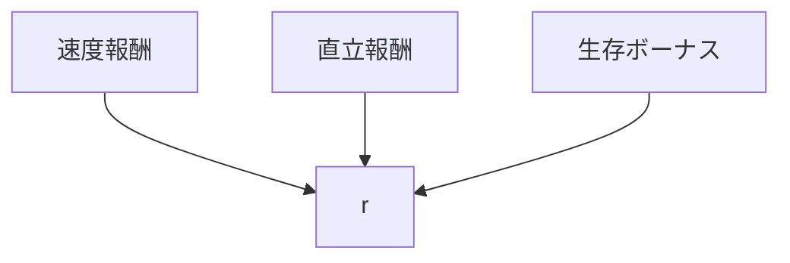

# 32. 寄り道4 — Walker2d と Ant で歩行

> **この寄り道は何につながるか**
> 二足（Walker2d）と四足（Ant）で歩く＝**周期運動と歩容**。人型が「物体まで歩いて近づく」能力の直前の段階です。
> 二足のバランス制御は、人型の歩行（第35章）にほぼ直結します。

## この章でわかること

- 二足歩行（Walker2d）と四足歩行（Ant）の違い
- 「歩容（gait）」と周期運動
- 人型歩行への橋渡し

## 前提

- 第31章（接地・速度報酬）、第12章（PD制御）

---

## 1. 二足歩行（Walker2d）

胴体に2本の脚がついたロボットが前進します。Hopper より安定しますが、二足ならではの難しさがあります。



- **支持脚と遊脚の切り替え**: 片足で体を支えながら、もう片足を前に運ぶ。
- **重心の制御**: 重心が支持足の上に来るようバランスを取る。
- **周期運動**: 左右のステップが周期的に繰り返される。

> **つながり**: 人型の歩行は、この Walker2d を腕・体幹込みに拡張したものです。Walker2d が歩ければ、人型でも「歩く」は近い。

## 2. 四足歩行（Ant）

4本脚のロボットが前進します。

- より安定（常に複数脚で支持）。
- 脚の協調（どれをいつ動かすか）が課題。
- 参考: 四足の歩容には walk / trot / gallop などがあります。

四足は人型には直接対応しませんが、「**多自由度の協調制御**」を学ぶ良い題材です。ゲームでいう「獣型の敵」にも通じます。

## 3. 報酬 — 歩行の共通形

Hopper と同じく、速度追従＋生存に、直立の項を足します（第17章・第25章）。

$$
r = \underbrace{\exp(-2(v^*-v)^2)}_{\text{速度追従}} + \underbrace{w_u\,\exp(-k\theta^2)}_{\text{直立}} + \underbrace{0.1}_{\text{生存}}
$$

- $\theta$ … 胴体の傾き。直立しているほど高い。



> **つながり**: 直立報酬は、人型が倒れずに歩くために不可欠です。論文の「体が地面に近づいたら終了」（第24章）と合わせ、転倒を避ける行動を学ばせます。

## 4. 学習の難しさと「歩容の獲得」

最初は「その場で転ぶ」「跳ねて進む」などの奇妙な動きをしますが、学習が進むと**きれいな周期歩容**が出てきます。


- 序盤の「跳ねて進む」は、速度報酬への**報酬ハッキング**（第17章）。
- これを抑えるのが AMP のスタイル報酬です。**Walker2d に AMP を入れると、より自然な歩容になります**（第34章・第35章）。

## 5. 実行

```bash
# 二足歩行
uv run python scripts/train_04_walker.py

# 四足歩行
uv run python scripts/train_04_walker.py --ant
```

## 6. 「つながり」のまとめ

| Walker2d / Ant で学ぶこと | 人型/論文での対応 |
| --- | --- |
| 二足の歩容とバランス | 人型の歩行（第35章） |
| 直立報酬 | 転倒回避、体幹制御 |
| 多自由度の協調 | 全身の関節制御 |
| 報酬ハッキング（跳ねる） | AMP スタイル報酬で抑制（第34章） |

## 7. ここまでの到達点


寄り道4つで、人型に必要な能力（体幹・腕・接地・歩行）を一通り経験しました。次は、PPO と AMP を自分で実装し、人型に統合します。

## 8. 実装コード

- `src/ml_lern/charcontrol/envs/locomotion.py` … `Walker2dEnv`, `AntEnv`
- `scripts/train_04_walker.py`

## まとめ

- Walker2d は二足歩行。人型歩行に最も近い。
- Ant は四足で、多自由度の協調を学ぶ。
- 報酬は速度＋直立＋生存。直立報酬は転倒回避に効く。
- 「跳ねて進む」報酬ハッキングは AMP で抑える（第34章）。

## 手を動かそう

> **一歩目**: Walker2d を学習させ、歩容（gait）の変化を（ログや動画で）観察する。

```bash
uv run python scripts/train_04_walker.py
```

序盤は「跳ねる」、終盤は「歩く」に変わります。

**いじってみる**: 直立報酬の重みを変えると、転びやすさが変わる。AMP を入れると歩容がどう自然になるか（第34章）を試す。

**夢が広がる**:
- ゲームの二足・四足キャラ（獣、ロボット、モンスター）の移動 AI を作る。
- 地形に応じた歩容（坂、砂、雪）を学習させる。
- キャラの体格（足の長さ）を変えて、歩き方の違いを学習する。

## 演習

1. 二足歩行で「跳ねて進む」が起きるのはなぜか、速度報酬の観点で説明しましょう。
2. Walker2d と Ant で、学習の難しさがどう違うか予想しましょう。
3. 人型の歩行と Walker2d の歩行の違いを、腕と体幹の有無から述べましょう。

---

次章: [33. PPO を実装する](33_PPOを実装する.md) ／ 前章: [31. 寄り道3 — Hopper](31_寄り道3_Hopper.md)
