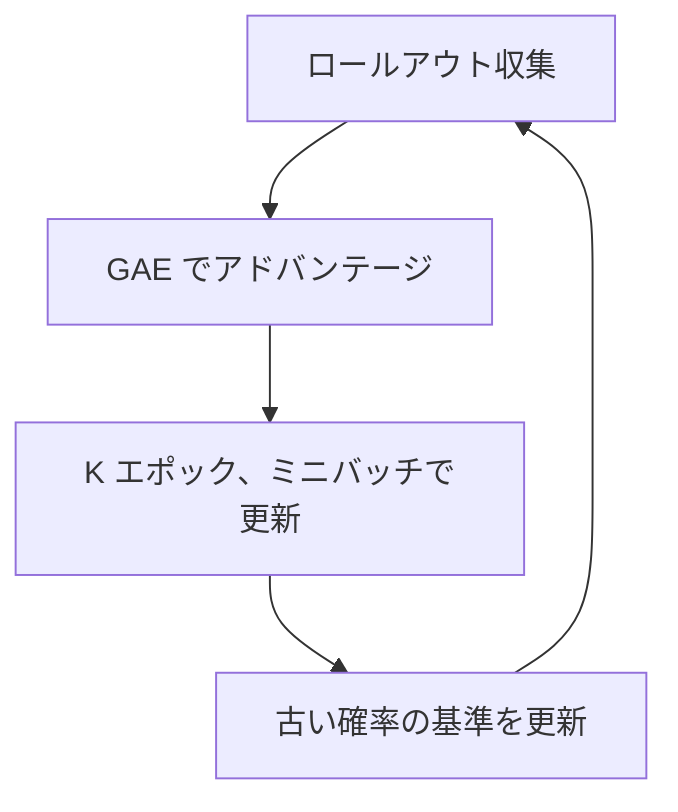

# 33. PPO を実装する — 方策・価値関数・更新

## この章でわかること

- ガウス方策（固定Σ）と価値関数の実装
- ロールアウトバッファと GAE
- クリップ付き目的関数の実装
- 学習ループの組み立て

## 前提

- 第16章（PPO）、第15章（GAE）、第03章（MLP）

## つながり

- この章の PPO が、次章の AMP と、第35章の人型統合の土台になります。

---

## 1. 方策と価値関数

方策は「状態＋目標 → ガウス分布の平均」。分散は固定します（第24章）。

```python
class Policy(nn.Module):
    def __init__(self, obs_dim, goal_dim, action_dim, hidden_dims=(1024, 512), action_std=0.25):
        super().__init__()
        self.net = _build_mlp(obs_dim + goal_dim, hidden_dims, action_dim)
        self.register_buffer("log_std", torch.full((action_dim,), float(torch.log(torch.tensor(action_std)))))
        self.action_dim = action_dim

    def forward(self, obs, goal):
        return self.net(torch.cat([obs, goal], dim=-1))       # 平均 μ

    def distribution(self, obs, goal):
        mu = self.forward(obs, goal)
        std = torch.exp(self.log_std).expand_as(mu)
        return torch.distributions.Normal(mu, std)

    def act(self, obs, goal):
        dist = self.distribution(obs, goal)
        action = dist.sample()
        return action, dist.log_prob(action).sum(dim=-1)
```

価値関数は状態価値を出力します。

```python
class Value(nn.Module):
    def __init__(self, obs_dim, goal_dim, hidden_dims=(1024, 512)):
        super().__init__()
        self.net = _build_mlp(obs_dim + goal_dim, hidden_dims, 1)

    def forward(self, obs, goal):
        return self.net(torch.cat([obs, goal], dim=-1)).squeeze(-1)
```

> **つながり**: 第24章で確認した論文本体の構成（{1024, 512}、固定Σ）と一致させています。

## 2. ロールアウトバッファ

「貯めてから更新」の貯蔵庫です（第16章）。

```python
class RolloutBuffer:
    def __init__(self, num_steps, num_envs, obs_dim, goal_dim, action_dim, amp_obs_dim):
        self.obs = torch.zeros(num_steps, num_envs, obs_dim)
        self.goal = torch.zeros(num_steps, num_envs, goal_dim)
        self.actions = torch.zeros(num_steps, num_envs, action_dim)
        self.log_probs = torch.zeros(num_steps, num_envs)
        self.values = torch.zeros(num_steps, num_envs)
        self.rewards = torch.zeros(num_steps, num_envs)
        self.dones = torch.zeros(num_steps, num_envs)
        self.amp_obs = torch.zeros(num_steps, num_envs, amp_obs_dim)   # 識別器用（第34章）
```

## 3. GAE の実装

第15章の擬似コードをそのまま実装します（**逆順走査**）。

```python
def compute_gae(rewards, values, dones, gamma, gae_lambda, last_value):
    num_steps, num_envs = rewards.shape
    advantages = torch.zeros_like(rewards)
    last_gae = torch.zeros(num_envs)
    for t in reversed(range(num_steps)):
        next_value = last_value if t == num_steps - 1 else values[t + 1]
        not_done = 1.0 - dones[t]
        delta = rewards[t] + gamma * next_value * not_done - values[t]
        last_gae = delta + gamma * gae_lambda * not_done * last_gae
        advantages[t] = last_gae
    returns = advantages + values
    return advantages, returns
```

## 4. クリップ付き目的関数

第16章の式を実装します。

```python
log_probs, entropy = policy.evaluate_actions(mb_obs, mb_goal, mb_actions)
ratio = torch.exp(log_probs - mb_old_log_probs)             # 確率比 r_t(θ)
surr1 = ratio * mb_advantages
surr2 = torch.clamp(ratio, 1 - eps, 1 + eps) * mb_advantages
policy_loss = -torch.min(surr1, surr2).mean()               # 最大化 → 負にして最小化

value_loss = ((values - mb_returns) ** 2).mean()            # 価値関数の回帰
entropy_loss = -entropy.mean()                               # 探索
loss = policy_loss + c1 * value_loss + c2 * entropy_loss
```

## 5. 学習ループ

```python
while True:
    buffer, obs, goal, ep_stats = collect_rollout(env, policy, value, amp, cfg, obs, goal)
    batch = buffer.flatten()
    last_value = value(obs, goal).detach()
    advantages, returns = compute_gae(buffer.rewards, buffer.values, buffer.dones,
                                      cfg.gamma, cfg.gae_lambda, last_value)
    ppo.update(batch, advantages.reshape(-1), returns.reshape(-1))
    # 識別器の更新は次章
```



## 6. 実行

```bash
uv run python scripts/p03_ppo.py          # 倒立振子で PPO
uv run python scripts/train_04_walker.py  # 二足歩行（AMP なし）
```

`ep_return` が増えていけば、PPO が機能しています。

## 7. 実装コードの場所

```
src/ml_lern/core/
  models.py     Policy, Value, Discriminator
  buffer.py     RolloutBuffer
  ppo.py        compute_gae, PPOUpdater
  rollout.py    collect_rollout
```

## 8. つまずきやすいポイント

| 症状 | 対処 |
| --- | --- |
| 収益が上がらない | 学習率、エントロピー係数、報酬スケールを見直す |
| KL が大きすぎる | クリップ幅を下げる、エポック数を減らす |
| 学習が不安定 | アドバンテージ正規化、勾配クリップを確認 |
| すぐ局所解 | エントロピー係数を上げる（探索を増やす） |

## まとめ

- 方策は「状態＋目標 → ガウス分布の平均」。分散は固定。
- バッファに貯めて、GAE でアドバンテージを計算し、PPO で更新する。
- クリップ付き目的関数で「一度に変えすぎない」。
- この PPO が、次章の AMP の土台になる。

## 手を動かそう

> **一歩目**: 自分の簡単なタスク（例: 2Dの点を目標へ動かす）を `gym.Env` で書き、PPO で学習させる。

```python
# 概念: SimpleTaskEnv（第13章）を自作タスクに置き換え、
# charcontrol.train の stage を自分の環境へ向ける
```

**いじってみる**: `clip_epsilon`、`entropy_coef`、`gamma` を変えて学習曲線を比較する。アドバンテージ正規化を外して不安定さを見る。

**夢が広がる**:
- 自分のゲームの「制御タスク」を PPO で解く。
- 学習ログを可視化（TensorBoard 等）してデバッグする。
- 学習済みモデルをゲームに組み込み、推論する。

**再現レシピ**: [レシピ34（付録F）](付録F_再現レシピ_物理側.md#recipe-34)（コメント付きの再現コードで試せます）

## 演習

1. GAE の走査を「逆順」にする理由を、依存関係の観点から説明しましょう。
2. アドバンテージ正規化を外すと、学習がどう不安定になるか予想しましょう。
3. クリップ幅 $\epsilon$ を 0.1 と 0.3 にしたとき、更新の大きさはどう変わるか述べましょう。
4. `action_std` を 0.25 から 0.5 にすると、探索はどう変わるか述べましょう。

---

次章: [34. AMP を実装する](34_AMPを実装する.md) ／ 前章: [32. 寄り道4 — Walker2d と Ant](32_寄り道4_Walker2dとAnt.md)
