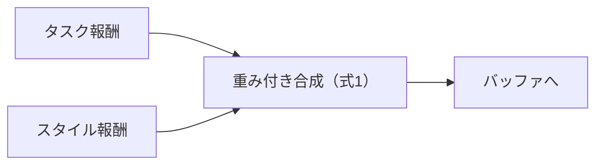
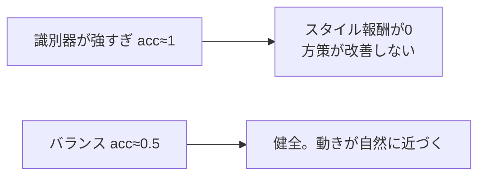

# 34. AMP を実装する — 識別器とスタイル報酬

## この章でわかること

- 識別器ネットワークと勾配ペナルティの実装
- スタイル報酬の計算とロールアウトへの組み込み
- 識別器の更新（本物 vs 偽物）
- 識別器の健全性の監視

## 前提

- 第19章（AMP）、第20章（AMP の実装）、第33章（PPO）

## つながり

- 第20章で概念を学びました。この章で、実際のコード（`core/amp.py`）として確認します。

---

## 1. 識別器ネットワーク

```python
class Discriminator(nn.Module):
    def __init__(self, amp_obs_dim, hidden_dims=(1024, 512)):
        super().__init__()
        self.net = _build_mlp(amp_obs_dim, hidden_dims, 1)

    def forward(self, amp_obs):
        return self.net(amp_obs).squeeze(-1)     # ロジット
```

- 入力 `amp_obs` は「状態遷移」（第19章）。物体を扱う場合、ここに物体が入ります（第36章）。

## 2. 勾配ペナルティ

```python
@staticmethod
def gradient_penalty(logits, inputs):
    grads = torch.autograd.grad(
        outputs=logits.sum(), inputs=inputs,
        create_graph=True, retain_graph=True, only_inputs=True,
    )[0]
    return grads.pow(2).sum(dim=-1).mean()
```

- 本物側の遷移にのみ適用（式(5)、第22章）。

## 3. スタイル報酬

```python
def style_reward(discriminator, amp_obs):
    with torch.no_grad():
        d = torch.sigmoid(discriminator(amp_obs))
        d = d.clamp(1e-4, 1 - 1e-4)
        return -torch.log(1.0 - d)              # 式(6)
```

## 4. ロールアウトへの組み込み

タスク報酬とスタイル報酬を合成します（式(1)、第22章）。

```python
r_style = amp_updater.predict_style_reward(next_amp_obs)
reward = (cfg.task_reward_weight * task_reward
          + cfg.style_reward_weight * cfg.amp_reward_scale * r_style)
```



## 5. 識別器の更新

本物（データ）を1、偽物（方策）を0として訓練します（式(3)(4)）。

```python
def update(self, policy_amp_obs, dataset_amp_obs):
    real = dataset_amp_obs[randperm(...)[:n]]
    fake = policy_amp_obs[randperm(...)[:n]]
    logits_real = self.discriminator(real)
    logits_fake = self.discriminator(fake)
    loss_real = self.bce(logits_real, torch.ones_like(logits_real))
    loss_fake = self.bce(logits_fake, torch.zeros_like(logits_fake))
    gp = Discriminator.gradient_penalty(self.discriminator(real_gp), real_gp)
    loss = loss_real + loss_fake + cfg.gradient_penalty_weight * gp
```

## 6. 健全性の監視

識別器の正解率を見ます（第20章）。

```python
acc_real = (torch.sigmoid(logits_real) > 0.5).float().mean()
acc_fake = (torch.sigmoid(logits_fake) < 0.5).float().mean()
```



## 7. 学習ループへの追加

第33章の PPO ループに、識別器の更新を足します。

```python
while True:
    buffer, obs, goal, ep_stats = collect_rollout(env, policy, value, amp, cfg, obs, goal)
    batch = buffer.flatten()
    advantages, returns = compute_gae(...)
    ppo.update(batch, advantages.reshape(-1), returns.reshape(-1))
    if amp is not None and dataset_amp_obs is not None:
        amp.update(batch["amp_obs"], dataset_amp_obs)      # 識別器の更新
```

## 8. 実行

```bash
uv run python scripts/p04_amp.py          # 識別器の単体動作
uv run python scripts/train_05_humanoid_amp.py   # 人型 + AMP（少し重い）
```

ログに `disc_loss`, `acc_r` が出ます。`acc_r` が 1 に張り付くなら、識別器が強すぎます（重み調整）。

## 9. 実装コードの場所

```
src/ml_lern/core/
  models.py   Discriminator
  amp.py      style_reward, AMPUpdater, gradient_penalty
  rollout.py  報酬の合成
```

## 10. つまずきやすいポイント

| 症状 | 対処 |
| --- | --- |
| 識別器が強すぎる | 識別器の学習率・更新頻度を下げる |
| スタイル報酬が0のまま | 重み・スケールを調整 |
| 学習が崩壊 | 勾配ペナルティの重みを調整 |
| 動きが不自然なまま | 見本データの質を疑う（第10章） |

## まとめ

- 識別器はロジットを出力し、二値分類で訓練する。
- 勾配ペナルティで安定化する（式(5)）。
- スタイル報酬は式(6)。タスク報酬と合成する（式(1)）。
- 正解率を監視し、識別器が強すぎないようにする。

## 手を動かそう

> **一歩目**: スタイル報酬の重みを 0（AMP なし）と 0.5 にして、動きの違いを比べる。

```bash
uv run python scripts/train_05_humanoid_amp.py
```

**いじってみる**: 参照モーションを「歩行」「走行」に差し替えて、スタイルが切り替わるか見る。勾配ペナルティの有無で安定性を比べる。

**夢が広がる**:
- 自分のゲームの MoCap で「らしい動き」を学習する。
- スタイル（重い/軽い、老若男女）を切り替えられるキャラを作る。
- 学習した識別器を、動きの品質チェックに使う。

## 演習

1. 勾配ペナルティの重みを 0 にするとどうなるか予想しましょう。
2. `acc_real` と `acc_fake` が両方 0.9 のとき、何が起きているか説明しましょう。
3. `amp_reward_scale` を入れる理由を、報酬スケールの観点で説明しましょう。
4. スタイル報酬の重み $w^S$ を 0 と大きくした場合の挙動を予想しましょう。

---

次章: [35. 人型で統合する](35_人型で統合する.md) ／ 前章: [33. PPO を実装する](33_PPOを実装する.md)
