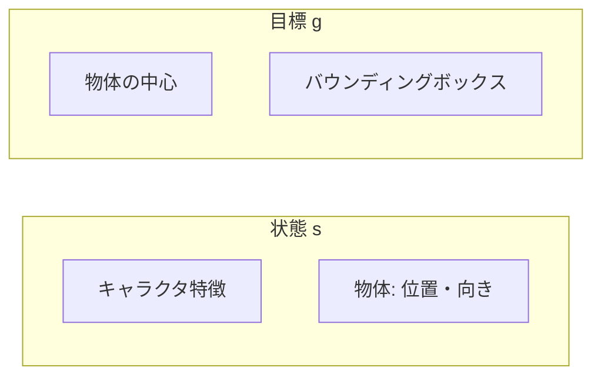
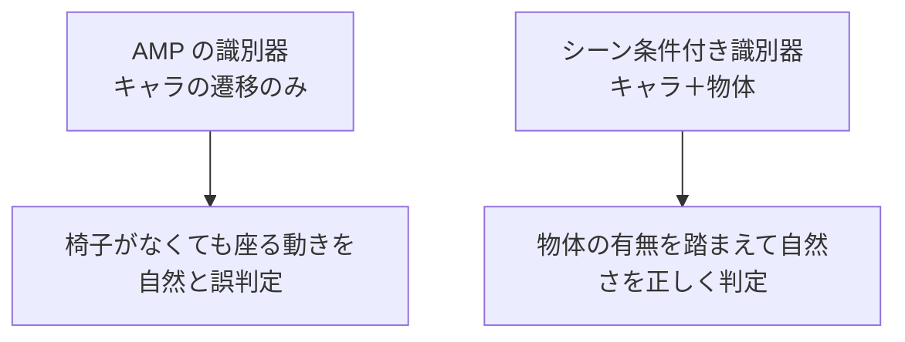

# 36. 物体とシーン条件付き識別器 — 論文の中核

## この章でわかること

- 人型に物体（椅子・箱相当の剛体）を追加する
- 論文の sit / carry をミニ実装向けに簡略化する
- 識別器を「キャラクタ遷移＋物体」に拡張する（シーン条件付け）
- 物体のランダム化と、効果を確かめるアブレーション

## 前提

- 第22章（シーン条件付き識別器）、第24章（データ・訓練）、第35章（人型 AMP）

## つながり

- ここが論文の中核です。第19章の AMP と、第22章のシーン条件付けが、実装として1つになります。

---

## 1. 物体を追加する

MuJoCo のモデルに物体（剛体）を追加します。`scene_env.py` の `SCENE_XML` がその例です。

```xml
<mujoco model="humanoid_scene">
  <include file="humanoid.xml"/>          <!-- 人型を流用 -->
  <worldbody>
    <body name="object" pos="2 0 0.5">
      <geom name="object_geom" type="box" size="0.3 0.3 0.5"/>
      <freejoint name="object_joint"/>    <!-- 物体は自由に動ける -->
    </body>
  </worldbody>
</mujoco>
```

- `freejoint` により、物体は6自由度で動きます（押せば転がる）。
- 論文の「物体は手に固定されず、力で動く」に対応します（第21章）。

## 2. 物体の状態を状態ベクトルへ

第23章の設計どおり、物体の位置・向きを状態に含めます。

```python
self.object_dim = 9                  # 位置(3) + 向き(6D)
self._object_state = torch.zeros(self.num_envs, self.object_dim)

# 目標: 物体の中心(3) + バウンディングボックス半サイズ(3)
self.goal_dim = 6
```



## 3. タスク報酬（論文の sit を簡略化）

第25章の式(7)〜(9)の構造を保ちます。

$$
r^G = 0.7\, r^{\text{near}} + 0.3\, r^{\text{far}}
$$

- $r^{\text{near}} = \exp(-10\, d^2)$ … 腰を物体中心に合わせる（式(9)と同型）。
- $r^{\text{far}} = \exp(-0.5\, d^2)$ … 物体へ近づく（式(8)の距離項を簡略化）。
- $d$ … キャラクタのルートと物体中心の距離。

```python
def task_reward(self, obs, goal, action, next_obs):
    root_xy = next_obs[..., :2]
    obj_xy = self._object_center[:, :2]
    dist = (obj_xy - root_xy).norm(dim=-1)
    r_near = torch.exp(-10.0 * dist.pow(2))
    r_far = torch.exp(-0.5 * dist.pow(2))
    far_mask = (dist > 0.5).float()                 # 0.5m でモード切替（式7）
    r_far_term = far_mask * r_far + (1 - far_mask) * 1.0
    return 0.7 * r_near + 0.3 * r_far_term
```

## 4. 物体のランダム化（第24章）

毎エピソード、物体の位置・向きをランダム化します。

```python
def _maybe_randomize(self, obs):
    lo, hi = self.cfg.init_obj_dist_range        # (1.0, 10.0)
    dist = torch.empty(...).uniform_(lo, hi)
    theta = torch.empty(...).uniform_(0.0, 2 * np.pi)
    x, y = dist * torch.cos(theta), dist * torch.sin(theta)
    self._object_center = torch.stack([x, y, torch.full_like(x, 0.5)], dim=-1)
```

- 物体はキャラクタから **1〜10m**、向きは **[0, 2π]**（第24章）。
- これが「未知の配置への一般化」の源です。

## 5. シーン条件付き識別器へ拡張（中核）

ここが論文の中核です。変更は `get_amp_obs` だけです。

```python
def get_amp_obs(self, obs, goal):
    """シーン条件付き識別器の入力（第22章）。"""
    return torch.cat([obs, self._object_state], dim=-1)   # キャラクタ＋物体
```

物体なしの場合はこうです（AMP 本来）。

```python
def get_amp_obs(self, obs, goal):
    return obs          # 物体なし
```



**たった1行の違いで、識別器は「物体の文脈込み」で自然さを判定するようになります。**

## 6. 効果を確かめるアブレーション

第26章のアブレーション（表S.1）を、ミニ実装で真似できます。**識別器の入力から物体を除く**と、どうなるかを比べます。

| 設定 | 期待される結果 |
| --- | --- |
| 物体を状態に含む（シーン条件付け） | 物体の文脈を踏まえた自然な相互作用 |
| 物体を状態から除く（AMP のまま） | 「物体を無視した」動きになりやすい |

> 論文では、バウンディングボックスを除くと carry の成功率が **0%** になりました（第26章）。物体情報の重要性を示す強い証拠です。

## 7. 物体は動く — 反応

第22章の重要ポイントを再確認します。

- キャラクタが物体を押せば、物体は動く（`freejoint`）。
- 状態に物体の**現在位置**を毎ステップ入れておけば、方策は反応できます。

```python
def _update_object_state(self):
    # 実運用では物体 joint の位置を環境から読み、反映する
    self._object_state[:, :3] = self._object_center
```

## 8. 実行

```bash
uv run python scripts/train_06_scene.py
```

> **正直な注意**: このミニ実装では、参照モーション（物体込み）はダミーです。論文レベルの自然な相互作用には、SAMP のような質の高いデータが必要です（第24章・付録D）。この章の目的は、**物体を状態に含めるパイプラインを通す**ことです。

## 9. つまずきやすいポイント

| 症状 | 対処 |
| --- | --- |
| 識別器が物体を無視している気がする | 物体特徴のスケール（正規化）を確認 |
| 学習が不安定 | 物体の次元を増やしすぎない、入力の正規化を見直す |
| 効果が実感できない | 参照モーションの質、ランダム化の範囲を確認 |

> 物体特徴の**スケール**は重要です。位置がメートル単位で大きく、関節角がラジアン単位で小さいと、識別器が物体に引きずられます。正規化を検討しましょう。

## 10. 実装コード

- `src/ml_lern/charcontrol/envs/scene_env.py` … `HumanoidSceneEnv`
- `scripts/train_06_scene.py`

## まとめ

- 人型に物体（剛体）を追加し、論文の sit / carry を簡略化した。
- 物体の位置・向きを状態に入れることから、シーン条件付けが始まる。
- 識別器の入力を「キャラクタ遷移＋物体」に拡張するのが論文の中核。
- 物体のランダム化と、アブレーションで効果を確かめる。

## 演習

1. `get_amp_obs` から物体を除いた版と含む版を、それぞれ何を学習するか比較しましょう。
2. 物体を状態に含めずに sit のタスク報酬だけ与えると、どんな問題が起きるか述べましょう。
3. 論文の「バウンディングボックスなしで carry 0%」を、あなたのミニ実装で再現するにはどう設計すべきか考えましょう。
4. 物体特徴のスケールが大きすぎると、識別器にどんな偏りが生じるか考察しましょう。

---

次章: [37. SMPL 人型へ合流](37_SMPL人型へ合流.md) ／ 前章: [35. 人型で統合する](35_人型で統合する.md)
