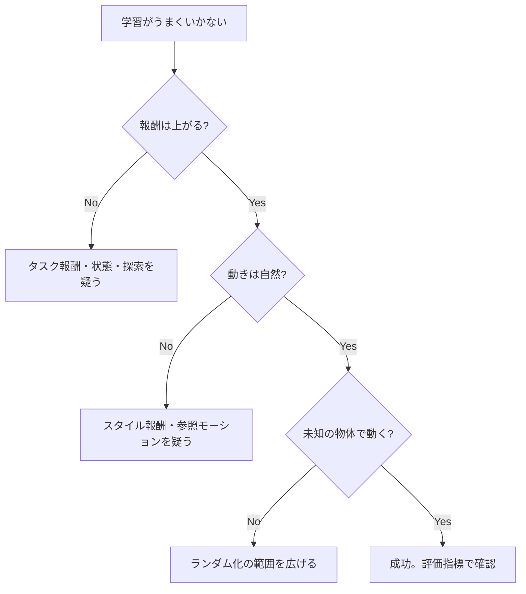
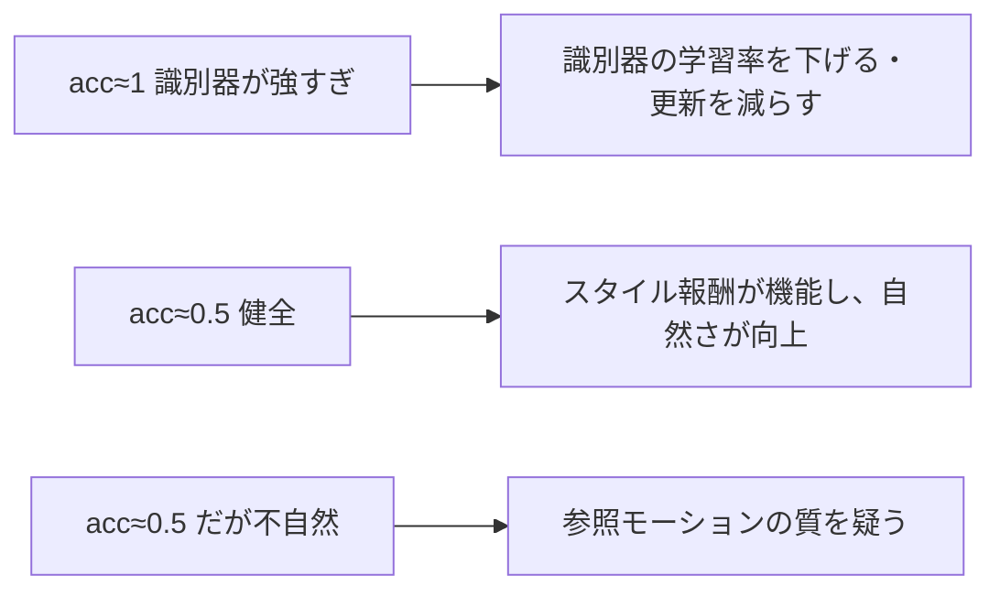
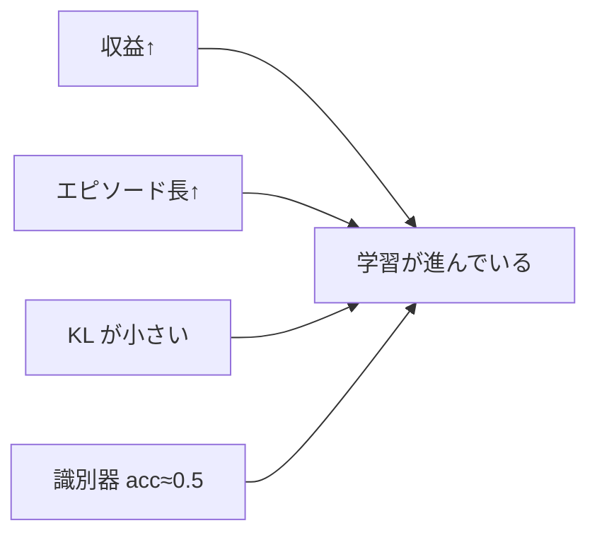

# 38. 評価とトラブル対応

## この章でわかること

- 論文と同じ評価指標（成功率・実行時間・精度）を自分で測る方法
- 学習がうまくいかないときの切り分け
- 物理キャラ RL 特有の失敗パターンと対処
- AMP のバランス調整とハイパーパラメータの目安

## 前提

- 第26章（論文の評価）、第34〜36章（AMP・人型・シーン）

---

## 1. 評価指標を自分で測る

論文の3指標（第26章）を、ミニ実装でも測ります。

| 指標 | 定義 | 測り方 |
| --- | --- | --- |
| 成功率 | 目標達成した割合 | 距離が閾値以内で終えた回数 / 全試行 |
| 実行時間 | 成功までの平均時間 | 成功したエピソードの長さの平均 |
| 精度 | 目標との平均ずれ | 終了時の距離の平均 |

```python
def evaluate(env, policy, num_trials=100, threshold=0.2):
    successes, times, precisions = 0, [], []
    for _ in range(num_trials):
        obs = env.reset()
        goal = env.goal
        done = torch.zeros(env.num_envs, dtype=torch.bool)
        steps = 0
        while not done.all():
            with torch.no_grad():
                action, _ = policy.act(obs, goal)
            obs, goal, task_r, done, _ = env.step(action)
            steps += 1
            if steps > MAX_STEPS:
                break
        dist = env.eval_distance()          # 環境ごとに実装
        precisions.append(dist.mean().item())
        successes += (dist < threshold).float().sum().item()
        times.append(steps)
    n = num_trials * env.num_envs
    return {"success_rate": successes / n,
            "exec_time": sum(times) / len(times),
            "precision": sum(precisions) / len(precisions)}
```

> 評価の条件も論文に合わせます: 物体から 1〜10m、ランダムな向き、未見の物体（第26章）。

## 2. トラブルシューティングの全体フロー



## 3. 「報酬が上がらない」とき

| 疑う点 | 確認・対処 |
| --- | --- |
| 報酬設計 | 目的に直結する報酬か。抜け道はないか（第17章） |
| 状態 | 必要な情報（物体、速度）が入っているか（第23章） |
| 探索 | エントロピー係数、行動分散が小さすぎないか |
| 学習率 | 大きすぎ（発散）/ 小さすぎ（進まない） |
| 早期終了 | 厳しすぎて常に即終了していないか（第24章） |
| 割引率 | 報酬の時間スケールに合っているか（第14章） |

## 4. 「動くが不自然」なとき

第32章で見た「跳ねて進む」などが典型です。

| 疑う点 | 確認・対処 |
| --- | --- |
| スタイル報酬の重み | $w^S$ を上げる（第22・34章） |
| 参照モーション | 質が悪い／ランダムすぎないか（第24章） |
| 識別器の強さ | 強すぎると勾配が流れない。学習率・更新頻度を調整（第34章） |
| 報酬のバランス | $w^G$ と $w^S$ の比（式1） |

### 識別器のバランス調整



## 5. 「未知の物体で動かない」とき

| 疑う点 | 対処 |
| --- | --- |
| ランダム化の範囲 | 物体サイズ・配置の範囲を広げる（第24・36章） |
| 物体特徴のスケール | 正規化を見直す（第36章） |
| 過学習 | 環境数・データ多様性を増やす |

> 論文のアブレーション（バウンディングボックスなしで carry 0%、第26章）は、「物体特徴の与え方」が決定的であることを示しています。

## 6. 物理キャラ RL 特有の失敗

| 症状 | 原因 | 対処 |
| --- | --- | --- |
| 体が地面にめり込む | 接触パラメータ、初期位置 | timestep、接触設定を見直す |
| 関節が暴れる | PDゲイン過大、目標角の急変 | `kp` を下げる、行動をクリップ |
| 足が滑る | 摩擦設定、制御周波数 | 摩擦を上げる、制御周波数を調整 |
| その場で震える | 報酬が静止を許す | 速度報酬を足す（第31章） |
| 転倒して立て直せない | 早期終了が早い、回復の報酬がない | RSI で転倒復帰も学習させる（第24章） |

## 7. 学習の可視化

- **エピソード収益**（タスク達成度）
- **エピソード長**（生き延びているか）
- **識別器の損失・正解率**（AMP のバランス）
- **KL ダイバージェンス**（PPO の更新の大きさ）
- **成功率**（最終指標）



## 8. ハイパーパラメータの目安

| パラメータ | 目安 | 効く場面 |
| --- | --- | --- |
| `learning_rate` | 1e-4 〜 3e-4 | 全般。大きいと不安定 |
| `clip_epsilon` | 0.1 〜 0.3 | PPO の更新幅 |
| `gamma` | 0.95 〜 0.99 | 長期的報酬の重視 |
| `gae_lambda` | 0.9 〜 0.95 | アドバンテージ推定 |
| `task_reward_weight` | 0.5 〜 0.8 | 目的達成の重視 |
| `style_reward_weight` | 0.2 〜 0.5 | 自然さの重視 |
| `gradient_penalty_weight` | 5 〜 20 | 識別器の安定化 |
| `action_std` | 0.1 〜 0.5 | 探索量 |

## 9. まとめ

- 論文の3指標（成功率・実行時間・精度）を自分で測る。
- 切り分けは「報酬が上がるか → 自然か → 一般化するか」の順。
- 不自然さはスタイル報酬と参照モーション、未知物体はランダム化と特徴スケールを疑う。
- 物理特有の失敗（めり込み・暴れ・滑り）には、PD・摩擦・タイミングの調整。

## 手を動かそう

> **一歩目**: 自分のタスクで成功率・実行時間・精度を測る `evaluate` を書き、学習前後で比べる。

```python
# 概念: 第38章の evaluate を自作環境に向ける
# 学習前: ほぼ失敗 / 学習後: 成功率が上がる を数値で確認する
```

**いじってみる**: 外乱テスト（投射物、物体移動）を入れ、成功率がどう下がるかを数値で見る。ハイパーパラメータを1つずつ変えて、どの指標が動くか記録する。

**夢が広がる**:
- 自分のゲーム AI の品質を、数値で継続的に測定する仕組みを作る。
- プレイテストを自動化（多数の初期条件で AI を走らせる）。
- 失敗例を集めて、学習の改善に回す。

## 演習

1. 自分のミニ実装で、成功率・実行時間・精度を測る関数を書きましょう。
2. 「動くが不自然」なとき、最初に確認すべき項目を3つ挙げ、理由とともに述べましょう。
3. 識別器の `acc_real` が 0.99 に張り付いたときの対処を2つ挙げましょう。
4. 転倒して立て直せないとき、RSI をどう使うと改善できるか説明しましょう。

---

次章: [39. 発展 — IsaacGym と PHC / PULSE への道](39_発展_IsaacGymとPHC_PULSE.md) ／ 前章: [37. SMPL 人型へ合流](37_SMPL人型へ合流.md)
