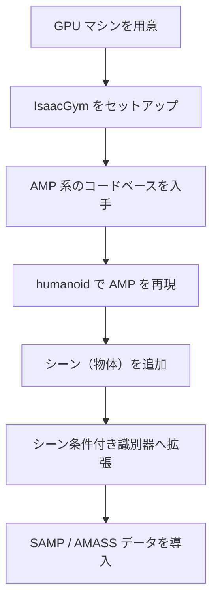
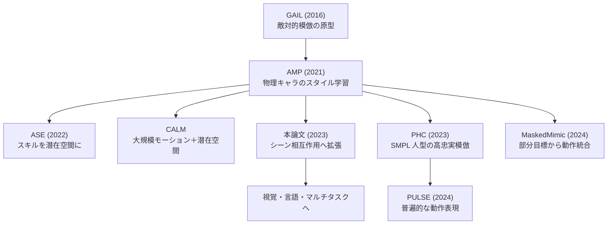
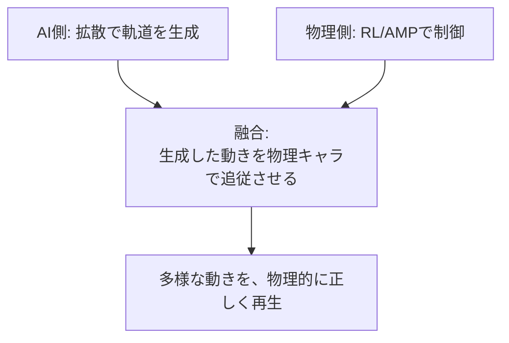
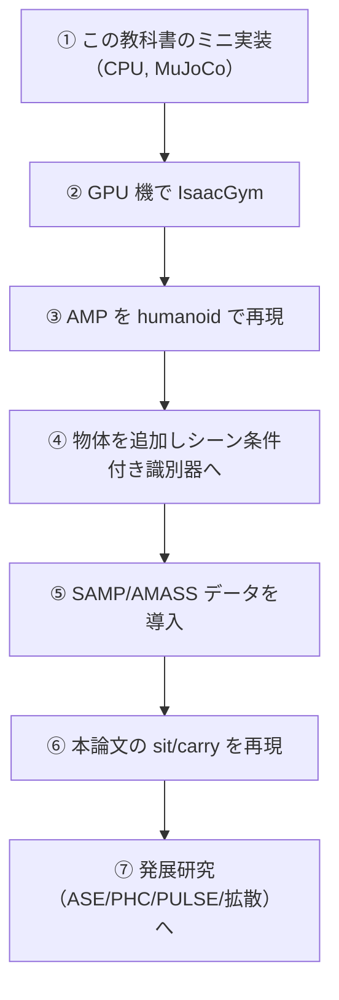

# 39. 発展 — IsaacGym と PHC / PULSE への道

## この章でわかること

- 論文の本実装（IsaacGym）に進むための手順
- 関連研究の地図（AMP / ASE / CALM / PHC / PULSE / MaskedMimic）
- AI側（拡散）と物理側（RL）の融合
- この教科書を終えた後の学習ロードマップ

## 前提

- 第1〜38章

---

## 1. 本実装（IsaacGym）に進む

論文のコードは **IsaacGym**（NVIDIA）を前提とします。IsaacGym は GPU 必須です（第11章）。

| 項目 | 要件 |
| --- | --- |
| GPU | NVIDIA GPU（CUDA 対応） |
| ドライバ | CUDA 対応の NVIDIA ドライバ |
| OS | Linux（Ubuntu 推奨） |

参考リポジトリ:

- **IsaacGymEnvs**（NVIDIA）: AMP を含む強化学習環境集。 <https://github.com/isaac-sim/IsaacGymEnvs>
- **AMP 公式**: <https://xbpeng.github.io/projects/AMP/index.html>
- **ASE / CALM / MaskedMimic**（Peng らの後続）。

> **この環境では IsaacGym は動きません**（virtio 仮想 GPU、CUDA なし、第28章）。本格版は GPU マシンで。

## 2. 関連研究の地図

| 研究 | 一言 | 本論文との関係 |
| --- | --- | --- |
| GAIL | 敵対的模倣の原型 | 源流（第19章） |
| AMP | 物理キャラのスタイル学習 | 直接の土台（第19章） |
| ASE | スキルを潜在空間へ | 発展 |
| CALM | 大規模モーション＋潜在空間 | 発展 |
| PHC | SMPL 人型の高忠実模倣 | 別系列（第37章） |
| PULSE | 普遍的動作表現 | PHC の発展 |
| MaskedMimic | 部分目標から動作統合 | 発展 |

## 3. AI側と物理側の融合

第2部で、拡散モデルによるモーション生成（AI側）を学びました。第4〜5部で、物理制御（物理側）を学びました。この2つは、実際の研究では融合が進んでいます。

| 融合の形 | 内容 |
| --- | --- |
| 生成 → 追従 | 拡散で作ったモーションを、モーショントラッキング（第18章）で物理キャラに追従させる |
| Diffusion Policy | 生成モデルを方策として使い、物理制御する（第10章） |
| 生成を事前分布に | 生成モデルの分布を、AMP の事前分布として使う |

> 論文の「動作の分布を学ぶ」という目的は、拡散でも AMP でも同じです（第10章）。両者を組み合わせるのが、次の一歩です。

## 4. 現実的な道筋

| 段階 | 効く章 |
| --- | --- |
| ② IsaacGym 導入 | 第11・28章 |
| ③ AMP 再現 | 第19・33・34・35章 |
| ④ シーン条件付け | 第22・36章 |
| ⑤ データ導入 | 第24・37章・付録D |
| ⑥ sit/carry 再現 | 第21・25・26章 |

## 5. 計算資源の現実

| 環境 | できること |
| --- | --- |
| この環境（CPU, 5GiB, CUDAなし） | 倒立振子〜Walker 程度。humanoid は遅い |
| デスクトップ GPU（1枚） | humanoid の AMP、シーン条件付けまで |
| 複数 GPU / クラウド | 本論文の規模（数千環境）に近づける |

## 6. さらに学ぶべきトピック

- **ビジョンと言語**: キャラクタが環境を「見て」、指示に従う（論文の将来課題、第26章）。
- **マルチタスク RL**: 1つの方策で複数タスク（第26章の限界）。
- **Sim-to-Real**: シミュレーションの制御を実ロボットへ。
- **拡散モデル**: 生成モデルによる動作生成（第2部・第10章）。

## 7. よくある質問

**Q. GPU がないと無理ですか？**
A. この教科書のミニ実装は CPU で動きます。本格版（humanoid、数千環境）は GPU を強く推奨します。

**Q. 論文の完全な再現は必要ですか？**
A. まず「AMP の核」と「シーン条件付け」を理解することが重要です。完全再現は GPU とデータ（ライセンス）が必要です。

**Q. SMPL は必須ですか？**
A. 必須ではありません。MuJoCo の標準 humanoid でも核は体験できます（第35章）。SMPL はより本格的な人体モデルを使いたいときの選択肢です（第37章）。

**Q. 拡散モデルはどこで使うのですか？**
A. 論文は使いませんが、AI側のモーション生成の柱です（第2部）。物理側と融合する研究が進んでいます。

## 8. まとめ

- 本実装は IsaacGym（GPU 必須）。この環境では動かない。
- 関連研究の地図（ASE / CALM / PHC / PULSE / MaskedMimic）を把握する。
- AI側（拡散）と物理側（RL）の融合が次の一歩。
- 現実的な道筋は、ミニ実装 → GPU で IsaacGym → AMP 再現 → シーン条件付け → データ導入 → sit/carry。

## 演習

1. 自分の計算資源で、どの段階まで到達できそうか、現実的に計画を立てましょう。
2. PHC（モーション模倣）と本論文（シーン相互作用）の共通点と相違点を整理しましょう。
3. AI側（拡散）と物理側（RL）を融合すると、どんな利点があるか考察しましょう。
4. 「キャラクタに目（ビジョン）を持たせる」と、本論文の何が改善されるか考察しましょう。

---

第7部はここまで。付録: [付録A 用語集](付録A_用語集.md) ／ [付録B 数学の補足](付録B_数学の補足.md) ／ [付録C 演習問題](付録C_演習問題.md) ／ [付録D 参考リソースとライセンス](付録D_参考リソースとライセンス.md)
