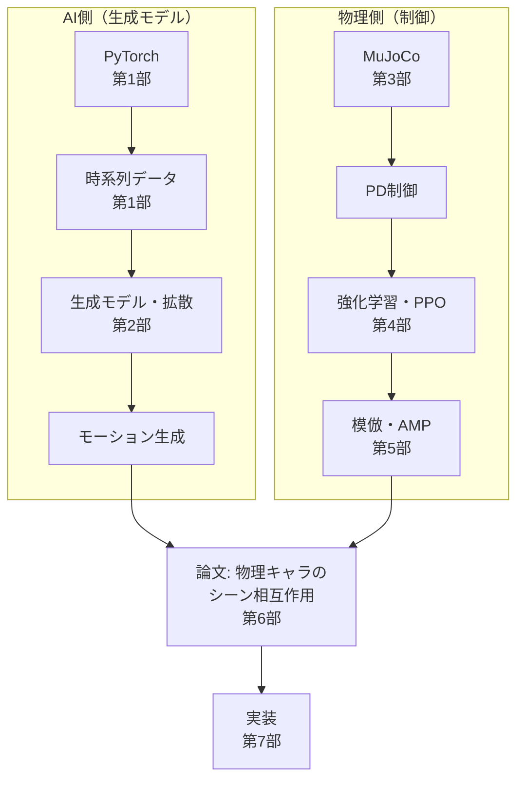

# アニメーションAI学習パス — PyTorch から物理キャラクタ、シーン相互作用へ

この教科書は、ゲームエンジニアを読者として想定し、**アニメーションAIを実際に動かせるようになる**ための学習パスです。ゴールは次の論文の理解と実装です。

> Mohamed Hassan, Yunrong Guo, Tingwu Wang, Michael Black, Sanja Fidler, Xue Bin Peng.
> **Synthesizing Physical Character-Scene Interactions.**
> arXiv:2302.00883 (2023).
> <https://arxiv.org/abs/2302.00883> ／ [補助動画](https://youtu.be/q3hyQdaElQQ)

## この本の考え方 — 「AI側」と「物理側」の二本柱

アニメーションAIには、大きく2つの技術の柱があります。本教科書はこの2つを別々に積み上げ、最後に論文で統合します。



- **AI側の学習**（第1〜2部）: PyTorch、時系列データ、生成モデル（拡散モデル）。ノイズからモーションを作る側。
- **物理側の学習**（第3〜5部）: MuJoCo、PD制御、強化学習（PPO）、DeepMimic / AMP。物理シミュレーション上でキャラクタを制御する側。
- **統合**（第6〜7部）: 論文を読み、実際に手を動かして実装する。

## 対象読者

- C++ / C# や Unity / Unreal でゲームを触ったことがある。
- 剛体物理、アニメーション、状態機械などに馴染みがある。
- **機械学習・深層学習・強化学習は初めて**（Python と数式の基礎は本編で説明します）。

## 読み方

- 通読は **第0部 → 第1部 → … → 第7部 → 付録** の順を推奨。
- コードは各章に埋め込み、対応する実装は `src/ml_lern/` にあります（後述）。
- 各章の冒頭に「この章でわかること」「前提」「つながり」を置いています。
- 各章の末尾に **「手を動かそう」**（一歩目・いじってみる・**夢が広がる**発展）と、対応する **「再現レシピ」**（付録E・Fへのリンク）と「演習」があります。手を動かす要素は、理解確認よりも **応用・作品づくりのヒント** を重視しています。まずは「一歩目」のコマンドを1つ実行してみてください。
- **再現レシピ**（[付録E](付録E_再現レシピ_AI側.md) / [付録F](付録F_再現レシピ_物理側.md)）は、「夢が広がる」を実際に手で再現するためのコメント多めのコード集です。実行できるコードは `recipes/` にあります。

## 全体構成

### 第0部 はじめに

| # | 章 |
| --- | --- |
| 00 | [00_はじめに.md](00_はじめに.md) |

### 第1部 Python と深層学習の基礎

| # | 章 |
| --- | --- |
| 01 | [01_PythonとNumPy.md](01_PythonとNumPy.md) |
| 02 | [02_PyTorchの基礎.md](02_PyTorchの基礎.md) |
| 03 | [03_ニューラルネットと学習.md](03_ニューラルネットと学習.md) |
| 04 | [04_時系列データの扱い.md](04_時系列データの扱い.md) |
| 05 | [05_系列モデル入門.md](05_系列モデル入門.md) |

### 第2部 生成モデルと拡散モデル

| # | 章 |
| --- | --- |
| 06 | [06_生成モデルの基礎.md](06_生成モデルの基礎.md) |
| 07 | [07_敵対的生成_識別器.md](07_敵対的生成_識別器.md) |
| 08 | [08_拡散モデルの概念.md](08_拡散モデルの概念.md) |
| 09 | [09_拡散モデルの実装.md](09_拡散モデルの実装.md) |
| 10 | [10_モーション生成への拡張.md](10_モーション生成への拡張.md) |

### 第3部 物理シミュレーションの基礎

| # | 章 |
| --- | --- |
| 11 | [11_物理エンジン入門_MuJoCo.md](11_物理エンジン入門_MuJoCo.md) |
| 12 | [12_シミュレーションの1ステップ.md](12_シミュレーションの1ステップ.md) |
| 13 | [13_シミュレータで人型を動かす.md](13_シミュレータで人型を動かす.md) |

### 第4部 強化学習

| # | 章 |
| --- | --- |
| 14 | [14_強化学習の基礎.md](14_強化学習の基礎.md) |
| 15 | [15_方策勾配とアドバンテージ.md](15_方策勾配とアドバンテージ.md) |
| 16 | [16_PPO.md](16_PPO.md) |
| 17 | [17_物理キャラクタのRL.md](17_物理キャラクタのRL.md) |

### 第5部 模倣学習と Adversarial Motion Priors

| # | 章 |
| --- | --- |
| 18 | [18_模倣学習とDeepMimic.md](18_模倣学習とDeepMimic.md) |
| 19 | [19_敵対的模倣とAMP.md](19_敵対的模倣とAMP.md) |
| 20 | [20_AMPの実装.md](20_AMPの実装.md) |

### 第6部 論文を読む

| # | 章 |
| --- | --- |
| 21 | [21_論文の全体像.md](21_論文の全体像.md) |
| 22 | [22_手法_シーン条件付き識別器.md](22_手法_シーン条件付き識別器.md) |
| 23 | [23_状態と行動の表現.md](23_状態と行動の表現.md) |
| 24 | [24_データセットと訓練.md](24_データセットと訓練.md) |
| 25 | [25_報酬関数を読む.md](25_報酬関数を読む.md) |
| 26 | [26_結果と比較.md](26_結果と比較.md) |

### 第7部 実装（人型本線＋寄り道）

| # | 章 |
| --- | --- |
| 27 | [27_実装の全体像.md](27_実装の全体像.md) |
| 28 | [28_環境構築.md](28_環境構築.md) |
| 29 | [29_寄り道1_倒立振子.md](29_寄り道1_倒立振子.md) |
| 30 | [30_寄り道2_Reacher.md](30_寄り道2_Reacher.md) |
| 31 | [31_寄り道3_Hopper.md](31_寄り道3_Hopper.md) |
| 32 | [32_寄り道4_Walker2dとAnt.md](32_寄り道4_Walker2dとAnt.md) |
| 33 | [33_PPOを実装する.md](33_PPOを実装する.md) |
| 34 | [34_AMPを実装する.md](34_AMPを実装する.md) |
| 35 | [35_人型で統合する.md](35_人型で統合する.md) |
| 36 | [36_物体とシーン条件付き識別器.md](36_物体とシーン条件付き識別器.md) |
| 37 | [37_SMPL人型へ合流.md](37_SMPL人型へ合流.md) |
| 38 | [38_評価とトラブル対応.md](38_評価とトラブル対応.md) |
| 39 | [39_発展_IsaacGymとPHC_PULSE.md](39_発展_IsaacGymとPHC_PULSE.md) |

### 付録

| # | 章 |
| --- | --- |
| A | [付録A_用語集.md](付録A_用語集.md) |
| B | [付録B_数学の補足.md](付録B_数学の補足.md) |
| C | [付録C_演習問題.md](付録C_演習問題.md) |
| D | [付録D_参考リソースとライセンス.md](付録D_参考リソースとライセンス.md) |
| E | [付録E_再現レシピ_AI側.md](付録E_再現レシピ_AI側.md) |
| F | [付録F_再現レシピ_物理側.md](付録F_再現レシピ_物理側.md) |

## 実装コードの場所

```
src/ml_lern/
  foundations/   第1部: テンソル・NN・時系列・系列モデル
  generative/    第2部: AE/VAE・GAN・拡散モデル
  core/          第3〜5部: MuJoCo・RL・PPO・AMP・報酬・模倣
  charcontrol/   第6〜7部: 環境（寄り道〜人型〜シーン〜SMPL）・学習
  docsite/       docs/ をブラウザ表示するツール
scripts/         各段階のエントリポイント
recipes/         再現レシピ（付録E・F）の実行コード
```

| スクリプト | 章 |
| --- | --- |
| `scripts/f01_tensors.py` 〜 `f03_timeseries.py` | 第1部 |
| `scripts/g01_vae.py` 〜 `g04_diffusion_motion.py` | 第2部 |
| `scripts/p01_mujoco_basics.py` 〜 `p04_amp.py` | 第3〜5部 |
| `scripts/train_01_pendulum.py` 〜 `train_07_smpl.py` | 第7部 |

## この本で扱わないこと

- 論文の完全な再現（IsaacGym を使う大規模並列学習は GPU が必要なため、第39章で手順として扱う）。
- 物理エンジンそのものの実装（衝突検出アルゴリズムなど）。

## 環境について（重要）

本リポジトリの開発環境は aarch64（ARM64）・CPU・メモリ約5GiB・**CUDA なし**です。そのため:

- 論文本来の **IsaacGym は動きません**。
- 第3部以降の物理・強化学習コードは **MuJoCo + PyTorch（CPU）** で動く小規模版です。
- 本文のコードは読者が自分の環境で動かす前提で、本リポジトリでは実行・検証していません。

依存の導入:

```bash
uv sync --extra train --extra viz    # PyTorch / MuJoCo など
```
