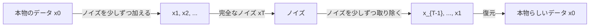
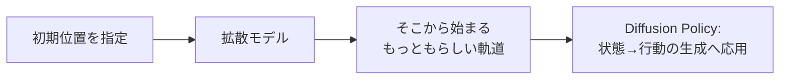
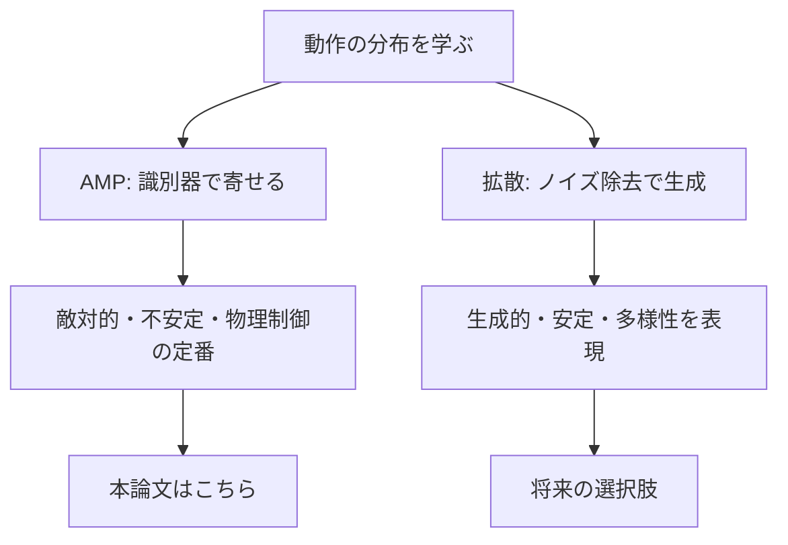

# 付録B 拡散モデルで動作を作る

> **重要**: この章は**本論文では使われていない関連技術**です。本論文は敵対的模倣学習（AMP）を使いますが、「動作の分布をどう学ぶか」という同じ問いに対する**別の答え**として拡散モデルを扱います。論文の手法と混同しないよう注意してください。

## この章でわかること

- 拡散モデル（Diffusion Model）の直感
- 2D バウンスボールの軌道生成を step by step で実装
- 条件付き生成と Diffusion Policy への入口
- AMP（敵対的）と拡散（生成的）の対比

## 前提

- 第03〜05章（模倣・敵対学習・AMP）

---

## 1. なぜ拡散モデルを学ぶのか

第03〜05章で、AMP が「識別器で本物らしさを競わせ、動作の分布に似せる」ことを学びました。拡散モデルは、**同じく「動作の分布」を学ぶ**のですが、方法がまったく違います。

| 観点 | AMP（敵対的） | 拡散モデル（生成的） |
| --- | --- | --- |
| 学習の仕組み | 識別器と方策を競わせる | ノイズ除去を回帰で学ぶ |
| 訓練の安定性 | 不安定になりやすい | 安定（単純な回帰） |
| 多様性 | 分布内で自然に多様化 | 多峰性を明示的に表現 |
| 制御への応用 | 物理キャラ制御の定番 | Diffusion Policy として注目 |
| 計算コスト | 1回の推論で行動 | 生成に複数ステップ必要 |

> **つながり**: 論文 Fig.7 は「同じ椅子でも様々な座り方（多様性）」を示します（第13章）。拡散モデルは、この多様性を生成モデルとして明示的に扱うアプローチです。将来のキャラ制御の選択肢として知っておく価値があります。

## 2. 拡散モデルの直感

拡散モデルのアイデアは驚くほど単純です。



1. **前方過程**: 本物のデータに、少しずつノイズを加える。
2. **逆過程**: ノイズからデータを復元する（ノイズ除去）。

学習するのは「逆過程」＝**ノイズ除去ネットワーク**です。ネットワークは「このノイズ付きデータに、どんなノイズが加えられたか」を予測します。

> Jonathan Ho, Ajay Jain, Pieter Abbeel.
> **Denoising Diffusion Probabilistic Models.**
> NeurIPS 2020. <https://arxiv.org/abs/2006.11239>

## 3. 前方過程（ノイズを加える）

時刻 $t$ のノイズ付きデータ $x_t$ は、元データ $x_0$ から計算できます。

$$
x_t = \sqrt{\bar\alpha_t}\, x_0 + \sqrt{1 - \bar\alpha_t}\, \epsilon, \qquad \epsilon \sim \mathcal{N}(0, I)
$$

- $\bar\alpha_t$ … ノイズの残存率（時刻とともに減る）。
- $\epsilon$ … 加えたノイズ。

$t$ が大きいほどノイズが増え、$t = T$ でほぼ完全なノイズになります。

## 4. 学習はとても単純

拡散モデルの学習は、AMP のような敵対的学習と違い、**回帰問題だけ**です。

```pseudo
for バッチ:
    x0 = 本物のデータをサンプル
    t  = ランダムな時刻
    eps = ランダムなノイズ
    x_t = sqrt(a_bar[t]) * x0 + sqrt(1 - a_bar[t]) * eps
    loss = MSE( model(x_t, t), eps )     # 加えたノイズを当てる
    勾配で model を更新
```

加えられたノイズ $\epsilon$ を当てるだけ。これだけです。

## 5. 実装: バウンスボールのデータ

`src/ml_lern/diffusion/dataset.py` で、箱の中を跳ねるボールの軌道（x, y の時系列）を生成します。

```python
def simulate_bounce(steps=64, dt=0.05, box=1.0, gravity=2.0, x0=None, v0=None):
    # 重力＋壁で速度反転
    for _ in range(steps):
        vel[1] -= gravity * dt          # 重力
        pos = pos + vel * dt
        for d in range(2):              # 壁で反射
            if pos[d] < 0: pos[d], vel[d] = -pos[d], -vel[d]
            elif pos[d] > box: pos[d], vel[d] = 2*box - pos[d], -vel[d]
        traj.append(pos.copy())
    return np.stack(traj)
```

- 物理は単純（重力＋反射）なので、教師データを大量に作れます。
- 1本の軌道が「1つのデータ x_0」（64ステップ×2次元 = 128次元ベクトル）。

> **つながり**: 「物理でデータを作り、生成モデルで分布を学ぶ」流れは、AMP が MoCap から動きの分布を学ぶのと対比できます（付録Bのテーマ）。

## 6. 実装: ノイズ除去ネットワーク

`model.py` の `Denoiser` は、ノイズ付き軌道 $x_t$ と時刻 $t$ から、ノイズ $\epsilon$ を予測します。

```python
class Denoiser(nn.Module):
    def forward(self, x_t, t, condition=None):
        t_emb = sinusoidal_embedding(t, self.time_dim)   # 時刻を埋め込む
        inp = torch.cat([x_t.reshape(batch,-1), t_emb, condition], dim=-1)
        return self.net(inp).reshape_as(x_t)
```

- 時刻 $t$ は**正弦波（sinusoidal）埋め込み**でベクトル化します（Transformer と同じ手法）。
- 条件付き生成では、初期位置 $x_0$ も入力に連結します（後述）。

## 7. 学習

`train.py` の学習ループは前述の擬似コードそのままです。

```python
t = torch.randint(0, num_timesteps, (batch,))
noise = torch.randn_like(x0)
x_t = schedule.q_sample(x0, t, noise)         # 前方過程
eps_pred = model(x_t, t, cond)                # ノイズを予測
loss = mse(eps_pred, noise)                    # 当てる
```

実行:

```bash
uv run python scripts/train_diffusion_bounce.py
```

## 8. 生成（無条件）

学習後は、完全なノイズから逆過程を回して軌道を生成します。

```python
x = torch.randn(num_samples, steps * 2)
for t in reversed(range(num_timesteps)):
    t_batch = torch.full((num_samples,), t, dtype=torch.long)
    x = schedule.p_sample_step(model, x, t_batch)
return x.reshape(num_samples, steps, 2)
```

- ランダムノイズから、**跳ねる軌道が生成**されます。
- 毎回少し違う軌道が出るのが「多様性」です。

## 9. 条件付き生成 — Diffusion Policy への入口

初期位置 $x_0$ を条件として与えると、**そこから始まる軌道**を生成できます。

$$
\text{model}(x_t, t, \text{条件}=x_0^{\text{start}})
$$

```python
def sample_conditional(model, schedule, steps, start_positions):
    return sample(model, schedule, steps, condition=start_positions)
```



> **つながり**: 条件付き生成は、制御における **Diffusion Policy**（Chi et al. 2023）の核です。状態を条件に、行動（の系列）を生成します。AMP が「確率的方策」で行動を出すのに対し、拡散は「生成モデル」で行動を出します。

> Cheng Chi, et al.
> **Diffusion Policy: Visuomotor Policy Learning via Action Diffusion.**
> RSS 2023. <https://arxiv.org/abs/2303.04137>

## 10. AMP との対比（まとめ）



| 項目 | AMP（本論文） | 拡散モデル（付録B） |
| --- | --- | --- |
| 訓練 | 識別器と方策を競わせる | ノイズ除去の回帰 |
| 安定性 | 不安定になりやすい | 安定 |
| 推論コスト | 低い（1回） | 高い（複数ステップ） |
| 多様性 | 分布内で自然 | 多峰性を明示 |
| 物体との相互作用 | シーン条件付けで対応 | 条件付けで対応可能 |

## 11. このデバイスでの実行

この章のコードは、**小さい MLP とデータ生成だけ**なので、CPU でも数分で動きます（第III部の humanoid 学習と違い、このデバイスでも検証可能です）。

> ただし、本リポジトリの方針（他章と同じく実行しない）に従い、本文では実行結果を掲載していません。読者の環境で `uv run python scripts/train_diffusion_bounce.py` を実行してください。

## まとめ

- 拡散モデルは「ノイズを加えて、取り除く」生成モデル。学習は単純な回帰。
- 2D バウンスボールの軌道で、無条件生成・条件付き生成を実装できる。
- 条件付き生成は Diffusion Policy への入口。
- 論文は使っていないが、「動作の分布を学ぶ」という点で AMP と対比できる関連技術。

## 演習

1. 前方過程で $t$ が大きくなるほど、$x_t$ はどうなるか説明しましょう。
2. 拡散モデルの学習が「単純な回帰」である理由を、AMP との違いから述べましょう。
3. 条件付き生成（初期位置を指定）が、制御にどう役立つか考察しましょう。
4. 生成に複数ステップが必要なことが、リアルタイム制御でどう問題になるか考えましょう。
